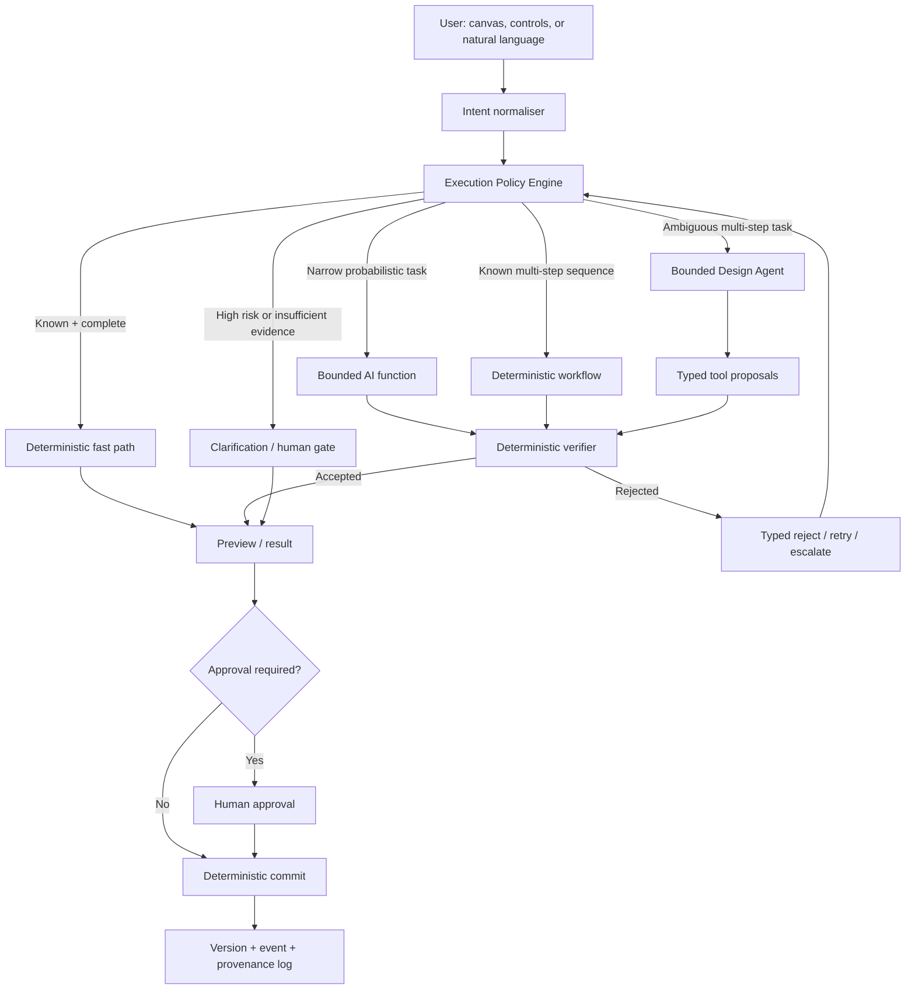

# Determinism-First Agentic Design Room

**Status:** High-level product and architecture investigation  
**Goal:** Deliver the best design-room experience with the lowest practical latency and cost, using agents only where ambiguity or multi-step reasoning creates material value.

---

## 1. Executive position

The product should be **agent-first in interaction, not agent-controlled in execution**.

The user should be able to express outcomes naturally:

> “Make this room warmer, preserve the wardrobe, keep the total under £3,000, and show three alternatives.”

The system should not respond by giving an unconstrained agent direct access to project state. Instead:

1. AI interprets the ambiguous request.
2. A deterministic policy engine chooses the cheapest suitable execution lane.
3. The agent produces typed proposals, not direct writes.
4. Deterministic services retrieve, calculate, validate, render, and persist.
5. The user sees a preview and explicit differences.
6. Approval commits a versioned change.

The core principle is:

> **Use determinism whenever the desired operation and its rules are known. Use AI to interpret, propose, rank, explain, or recover when the known workflow is insufficient.**

This is not “agents versus workflows.” It is a layered system in which agents sit above reliable workflows and invoke them as bounded tools.

---

## 2. What “agent-first” should mean

Agent-first should mean:

- the user can describe an outcome instead of learning every control;
- the system understands project context and current state;
- it can plan multi-step work when necessary;
- it asks only the questions that materially affect the result;
- it can operate the same tools available in the visual UI;
- all changes remain visible, reversible, attributable, and versioned.

It should **not** mean:

- every button click calls a language model;
- the agent decides factual calculations;
- the agent writes directly to the database;
- the agent silently changes firm preferences;
- a model confidence statement controls safety;
- the system loops until it happens to produce something acceptable.

The canvas and direct manipulation remain primary. The agent is an additional control surface and design collaborator.

### 2.1 Trade-off: agent-first versus static deterministic UI

There are three plausible product approaches.

#### A. Purely static and deterministic UI

The user progresses through forms, buttons, tables, filters, and fixed workflow steps.

**Advantages**

- lowest latency and inference cost;
- predictable and repeatable behaviour;
- easiest system to test, audit, secure, and explain;
- efficient for trained repeat users performing the same task;
- clear permissions and approval boundaries;
- well suited to calculations, product configuration, quantities, pricing, geometry, and procurement.

**Disadvantages**

- users must learn the product’s language and workflow;
- ambiguous design intent must be translated manually into fields and filters;
- every new workflow variation creates more UI controls and branching;
- the interface can become form-heavy and fragmented;
- novel or cross-cutting requests are difficult to express;
- personalisation tends to become configuration work rather than a natural interaction.

A static experience is strongest when the task is already well specified, such as configuring kitchen units, validating dimensions, building a schedule, or approving a quote.

#### B. Agent-first UI

The user begins with a goal and the agent chooses tools and steps.

**Advantages**

- much lower learning burden for occasional users;
- natural handling of ambiguous, incomplete, or multi-step requests;
- adapts interaction to the current project and user role;
- can bridge multiple workflows without exposing every underlying control;
- supports proactive identification of missing information and possible next actions;
- makes firm memory and prior decisions immediately useful.

**Disadvantages**

- higher latency and variable inference cost;
- less predictable behaviour and harder regression testing;
- users may not know what changed or why;
- conversational corrections can become slower than direct manipulation;
- incorrect confidence can conceal missing evidence;
- an agent-heavy product can feel like a generic AI wrapper or consumer design toy;
- critical workflows become fragile if they exist only through prompts.

An agent-first experience is strongest for design exploration, interpreting client feedback, coordinating several related changes, and helping infrequent users navigate a complex system.

#### C. Recommended hybrid: agent-first entry, deterministic workspace

The best design is not a compromise where every action is partly agentic. It is a deliberate split:

```text
express intent through agent or direct controls
→ route by task characteristics
→ execute with the lowest sufficient level of autonomy
→ show visual and structured differences
→ approve and commit deterministically
```

Users retain buttons, filters, tables, canvas manipulation, and keyboard/mouse precision. The agent operates the same underlying application services when natural-language coordination is more efficient.

This avoids two failure modes:

- **static-only:** reliable but increasingly complex and difficult to learn;
- **agent-only:** flexible but slow, expensive, opaque, and difficult to trust.

### 2.2 Does the interaction design determine the target customer?

Not by itself. The **underlying domain tools, data model, and verification rules** determine which markets the system can credibly serve. The agent changes accessibility and workflow flexibility; it does not create professional capability that the deterministic platform lacks.

The same design-room foundation can serve several professional segments, but each segment needs a different capability and policy pack.

| Segment | Where agent interaction adds value | Where deterministic workflow must dominate |
|---------|------------------------------------|---------------------------------------------|
| Interior designers | Interpret briefs, explore style, respond to client comments, coordinate revisions, source alternatives | Product identity, budgets, approved selections, schedules, rights, version history |
| Kitchen/bathroom firms | Turn consultation into options, explain trade-offs, suggest substitutions, identify missing requirements | Unit configuration, dimensions, appliance constraints, catalogue rules, price calculation, installation checks |
| Builders / design-and-build firms | Convert messy enquiries into structured scope proposals, flag omissions, compare options, draft client explanations | Work packages, quantities, rates, margins, exclusions, approvals, quote versions |
| Architects | Explore feasibility options, synthesise client constraints, compare design directions, prepare narratives | Measured geometry, planning constraints, technical evidence, stage gates, professional approvals |
| Homeowners | Guided brief capture, education, option exploration, clarification | Professional sign-off, measured fit, final pricing, procurement, construction/compliance decisions |

#### Segment-specific implications

**Interior design**

This is the most naturally agent-led segment because taste and client language are ambiguous. The canvas, comparison, firm style memory, and rapid visual revisions are central. However, a purely conversational interface would still be inferior to direct visual selection and editing.

**Kitchen and bathroom**

This should feel more like an intelligent configurator than a free-form image generator. The agent helps capture intent and navigate alternatives, but deterministic catalogues, module rules, dimensions, collisions, and prices create trust. Too much autonomy would reduce confidence.

**Builders and design-and-build**

The commercial workflow is fundamentally deterministic. An agent can structure incomplete enquiries, propose work packages, find likely omissions, and explain assumptions, but must not invent quantities or rates. A chat-only product would appear risky; visible workings and approval gates are essential.

**Architecture**

The agent can support option generation and feasibility narratives, while the authoritative workflow must distinguish inferred from measured evidence and visual concepts from technical decisions.

### 2.3 One platform, role-specific workspaces

Avoid building separate products too early. Use a shared project graph and application services with role-specific workspace composition:

```text
shared core:
  projects, rooms, scenes, concepts, versions, regions,
  products, measurements, constraints, approvals, provenance

role pack:
  allowed tools
  terminology and ontology
  default workflow
  approval policy
  uncertainty thresholds
  preferred outputs

workspace:
  visual canvas + relevant deterministic panels + agent command surface
```

Examples:

- Interior designer workspace emphasises concepts, references, products, client comparison, and FF&E schedules.
- Kitchen workspace emphasises units, appliances, dimensions, product configurations, price, and installation constraints.
- Builder workspace emphasises scope, quantities, rates, omissions, assumptions, and quote approval.

The agent receives only the tools and permissions appropriate to the active role and project stage.

### 2.4 Product and market risks created by each approach

**If the product is too agent-heavy**

- professionals may perceive it as a generic image wrapper;
- builders and kitchen firms may distrust commercial or spatial outputs;
- variable latency disrupts high-frequency operational work;
- the product becomes difficult to differentiate except through model quality.

**If the product is too static**

- the design experience may feel like traditional CAD/project software;
- users may struggle to translate client language into structured inputs;
- onboarding and configuration become consultancy-heavy;
- the platform misses the opportunity to learn from natural corrections and decisions.

**Hybrid positioning**

Position the product as a professional design workspace with an embedded design coordinator:

> “Work directly when you know what you want; describe the outcome when you do not. The system chooses the quickest safe path and always shows the workings.”

This supports expansion beyond interior designers without weakening the design-led entry point.

### 2.5 Design rules that preserve cross-segment flexibility

1. Never make a critical capability agent-only; expose the underlying structured control.
2. Route by task, evidence, and risk—not merely by customer persona.
3. Use role packs to set defaults and permissions without forking the platform.
4. Keep calculation, geometry, catalogue, pricing, and approval engines independent from the UI.
5. Let the user switch immediately from conversation to direct editing.
6. Persist agent output as typed project state, not conversational text.
7. Make uncertainty and assumptions visible in the professional artifact.
8. Evaluate value differently by segment: design time and approvals for designers; conversion for showrooms; omissions and quote time for builders.

---

## 3. Four execution levels

### Level 0 — Deterministic fast path

Use ordinary code when inputs, operation, and expected result are known.

Examples:

- move, rotate, resize, align, undo, or restore an object;
- enforce a budget ceiling;
- filter products by dimensions, supplier, availability, or price;
- calculate totals, waste, margin, or quantities;
- validate a state transition;
- check rights, permissions, collisions, or clearances;
- composite a selected product into a known mask;
- save a version or produce an export.

Properties:

- fastest;
- cheapest;
- reproducible;
- straightforward to test;
- authoritative for commercial, geometric, and permission decisions.

### Level 1 — Bounded AI function

Use one model call for a narrow probabilistic task with a typed output and deterministic validation.

Examples:

- extract constraints from a natural-language brief;
- classify room type or design intent;
- propose region labels or masks;
- describe why two design options differ;
- map “warm, calm, less showroom-like” into controlled style attributes.

The model returns a schema. Code validates, normalises, rejects, or asks for correction.

### Level 2 — Deterministic AI workflow

Use a fixed sequence when the task requires multiple AI or tool steps but the order is known.

Example:

```text
parse brief
→ validate required fields
→ retrieve references
→ generate low-resolution options
→ run geometry and protected-region checks
→ rank options
→ show user
```

The models can be stochastic while orchestration remains deterministic.

### Level 3 — Bounded agent

Use an agent only when:

- the goal is ambiguous or under-specified;
- the number or order of steps cannot be known in advance;
- different tools may be needed depending on intermediate evidence;
- exploration provides enough value to justify extra time and cost.

Examples:

- “Find a more distinctive direction without losing the firm’s character.”
- “Resolve this room under budget; change products or layout as necessary.”
- “Compare these client comments with the current concept and propose the smallest coherent revision.”
- “Investigate why every generated option feels too similar.”

The agent operates under:

- a typed tool allowlist;
- a maximum step, time, and cost budget;
- deterministic validators around every proposed action;
- approval requirements based on risk;
- a durable trace and resumable state.

### Level 4 — Human judgment or approval

Escalate when:

- required evidence is missing;
- consequences are high or irreversible;
- professional judgment is the product;
- deterministic checks disagree with the proposal;
- the request is genuinely novel;
- confidence has not been calibrated for this task class.

Examples include design sign-off, procurement approval, unverified dimensional fit, publication to a client, or adoption of a new firm-wide style rule.

---

## 4. The uncertainty-gated routing policy

The agent should not decide by itself whether the agent is needed. A deterministic **Execution Policy Engine** should route each request.

### 4.1 Separate uncertainty from risk

These are different:

- **Uncertainty:** how little the system knows about intent, inputs, evidence, or likely quality.
- **Risk:** the impact if the system is wrong.

A request can be:

- low uncertainty, low risk: move a selected chair 200 mm;
- high uncertainty, low risk: explore three playful colour directions;
- low uncertainty, high risk: approve a £15,000 procurement schedule;
- high uncertainty, high risk: verify wardrobe fit from one photograph.

Risk determines required controls. Uncertainty determines whether clarification, exploration, or escalation is useful.

### 4.2 Routing signals

Do not trust a model’s self-reported confidence as the main gate. Route using multiple observable signals:

**Intent completeness**

- Is the target object or room known?
- Are “preserve,” budget, supplier, and measurement constraints explicit?
- Are competing goals unresolved?

**Evidence sufficiency**

- Are required dimensions measured or merely inferred?
- Do products have verified dimensions or only images?
- Are reference rights and firm permissions known?

**Deterministic coverage**

- Is there already a tested handler for this operation?
- Can the output be fully checked against known invariants?

**Novelty / out-of-distribution**

- Is the request similar to previously successful requests?
- Has this firm accepted comparable actions before?
- Is retrieval similarity below the validated operating range?

**Disagreement**

- Do geometry, product, policy, or quality validators disagree?
- Do independently generated/ranked candidates produce unstable outcomes?

**Historical reliability**

- What is the acceptance-without-edit rate for this task, firm, model, and tool path?
- How often are results rolled back?

**Action characteristics**

- Is the action reversible?
- Is it visual-only, commercial, spatial, or externally visible?
- What is the financial or professional consequence?

**Experience budget**

- Did the user ask for speed or depth?
- Is the operation interactive or suitable for background exploration?
- Has the latency/cost budget already been consumed?

### 4.3 Routing rule

At a high level:

```text
if request violates policy:
    block with a precise reason
else if exact deterministic handler exists and inputs are complete:
    run deterministic fast path
else if one bounded AI transformation is sufficient and verifiable:
    run one structured model call
else if a known sequence covers the task:
    run deterministic workflow
else if task is exploratory, multi-step, reversible, and within budget:
    run bounded agent
else:
    ask a focused question or request human approval
```

The policy decision itself should be persisted:

```text
selected lane
routing signals
policy version
reason
latency budget
cost budget
approval requirement
fallback path
```

This creates the data needed to tune routing empirically.

---

## 5. The stochastic–deterministic boundary

Every model-proposed action should pass through the same four-part contract:

1. **Propose** — AI returns a typed action or plan.
2. **Verify** — deterministic code checks schema, state, permissions, constraints, geometry, budget, and policy.
3. **Commit** — a separate deterministic service performs the durable write.
4. **Reject** — a typed response explains the failed invariant and whether to retry, revise, or escalate.

For example:

```text
Agent proposal:
  replace sofa_01 with product_variant_123

Deterministic verification:
  region editable?
  product active?
  price within approved budget?
  product dimensions available?
  rights permit preview?
  candidate still available?

Commit:
  create selection proposal / preview version

Reject:
  budget_exceeded by £420
  suggested recovery: retrieve alternatives under £2,500
```

The agent never bypasses this boundary.

---

## 6. Proposed high-level architecture



### Main components

**1. Intent normaliser**

Converts natural language and canvas context into a typed `DesignRequest`:

```text
goal
target entities
hard constraints
soft preferences
protected entities
budget
requested output
quality preference
```

**2. Execution Policy Engine**

Chooses the lane and budgets. It is deterministic and versioned.

**3. Design Director agent**

One manager agent owns the conversation and calls bounded specialists as tools. Start with one agent; add specialists only when instructions, permissions, or evaluation criteria materially differ.

Potential specialists later:

- style/references;
- products and procurement;
- spatial/layout;
- evaluation and comparison.

They should normally be tools behind one stable manager, not independent personalities competing for control.

**4. Typed tool registry**

Tools should expose application capabilities, not database operations:

```text
read_project_state
search_firm_references
search_products
propose_region_patch
propose_scene_patch
render_preview
validate_geometry
validate_budget
compare_versions
explain_tradeoffs
request_approval
```

Read tools can run freely within tenant and project scope. Write tools create proposals; commit tools remain behind deterministic gates.

**5. Versioned project state**

The durable source of truth remains structured:

```text
project
→ scene / concept version
→ regions and protected entities
→ products and placements
→ constraints and measurements
→ approvals
→ event history
```

The conversation is not the source of truth.

**6. Agent run ledger**

Persist:

- request and interpreted intent;
- selected execution lane;
- model/provider;
- tool calls and outputs;
- verifier decisions;
- token, image, latency, and monetary costs;
- approvals and overrides;
- final user correction or rollback.

---

## 7. User experience design

### 7.1 One design room, three interaction modes

The user should not need to choose “deterministic” or “agentic.”

**Direct manipulation**

- Click, drag, rotate, replace, compare, undo.
- Always deterministic and immediate where possible.

**Command**

- “Replace this sofa with the selected product.”
- One clear action; use the fastest bounded path.

**Goal**

- “Rework this area so it feels less formal while keeping approved products.”
- Ambiguous multi-step objective; agent can propose a plan.

The router infers the required level.

### 7.2 Agent-first without becoming chat-first

The primary surface remains the design canvas. The agent appears through:

- a compact command bar;
- selection-aware suggestions;
- change cards showing before/after;
- a visible plan only for complex work;
- progress that identifies the current deterministic step;
- focused clarification questions;
- one-click accept, reject, edit, or undo.

Avoid long conversational explanations when a visual diff is clearer.

### 7.3 Progressive commitment

Use:

```text
suggest → preview → compare → approve → commit
```

The agent should be free to explore inside disposable preview branches. Only accepted changes update the authoritative project version.

### 7.4 Explain decisions, not internal reasoning

Show concise evidence:

```text
Why this option:
- matches the firm’s approved oak / limewash profile
- £340 below room budget
- preserves the approved wardrobe
- 18% less similar to the last two concepts
```

Do not expose hidden chain-of-thought. Show sources, constraints, checks, and trade-offs.

---

## 8. Design-room examples

### “Move the sofa left”

If the sofa is selected and the scene has coordinates:

- deterministic transform;
- deterministic collision check;
- immediate preview;
- no agent call.

If working from one 2D image without scene geometry:

- ask whether the user wants a visual-only edit;
- use a bounded image-edit workflow;
- label the result visual-only.

### “Make the room warmer”

The phrase is ambiguous:

1. bounded AI maps “warmer” to candidate attributes;
2. firm profile and project constraints provide context;
3. deterministic retrieval finds suitable references/products;
4. low-resolution options are generated;
5. geometry and protected-region checks reject regressions;
6. user compares options.

An agent is only needed if “warmer” requires deciding among multiple coordinated changes.

### “Keep the approved wardrobe, redesign everything else under £3,000”

This is a good bounded-agent task:

- identify protected and editable entities;
- decompose the budget;
- search products;
- propose coordinated substitutions;
- run deterministic totals and constraints;
- create preview alternatives;
- pause before committing selections.

### “Does this wardrobe fit?”

Never let an agent infer the answer from appearance.

- deterministic geometry check if verified measurements and product geometry exist;
- provisional warning if measurements are inferred;
- request survey data if evidence is insufficient.

### “Approve and order these products”

- agent may summarise;
- deterministic service refreshes offers, prices, availability, and totals;
- explicit human approval;
- deterministic procurement action with audit trail.

---

## 9. Cost and latency strategy

The economic unit should be **cost per accepted design action**, not cost per model call.

### Fast lane

Use:

- local state;
- cached product/reference results;
- deterministic calculations;
- precomputed embeddings;
- local compositing;
- direct scene transforms.

These should feel immediate.

### Assisted lane

For narrow interpretation/classification:

- use a small, fast model;
- request strict structured output;
- cache by input hash and policy/profile version;
- avoid repeating unchanged context.

### Agent lane

Before starting, assign:

```text
maximum steps
maximum retries
maximum model cost
maximum image generations
deadline / latency class
approval policy
```

Stop when:

- acceptance criteria pass;
- expected improvement is below threshold;
- budget is reached;
- a required fact is unavailable;
- repeated verifier rejection indicates a missing human decision.

### Model routing and cascades

Use the cheapest model with proven quality for the task:

1. route obvious tasks directly;
2. start bounded interpretation with a small model;
3. escalate only when deterministic checks fail or empirical confidence is low;
4. route complex visual reasoning directly to the capable tier rather than paying sequential latency for several failed models.

Quality estimators must be calibrated against your own review data. Raw model confidence is insufficient.

### Image generation

Image calls will dominate cost and latency. Therefore:

- deterministic/local previews first where acceptable;
- low-resolution exploration before final rendering;
- generate fewer but intentionally diverse candidates;
- reuse unchanged layers and approved regions;
- avoid chained edits unless the quality gain justifies drift and cost;
- use expensive refinement only on a selected option.

---

## 10. Memory and firm style

The agent should not have an opaque, self-editing “memory.”

Use three explicit layers:

### Firm policy memory

Approved, versioned rules:

- hard exclusions;
- preferred materials, eras, suppliers, and price bands;
- reference libraries;
- approval and procurement policies.

### Project memory

Current brief, measurements, client decisions, protected elements, approved products, and unresolved questions.

### Observed preference evidence

Events such as:

- accepted/rejected concept;
- manual correction;
- product swap;
- repeated negative feedback;
- rollback;
- approved profile update.

The agent may propose:

> “High-gloss marble has been rejected in four comparable projects. Avoid by default?”

Only a human-approved profile version changes firm policy.

---

## 11. Extension to 2.5D and 3D

The same boundary applies in 3D:

- AI proposes masks, depth, planes, camera poses, objects, or layouts;
- deterministic geometry owns coordinates, units, transforms, collision, clearance, and fit;
- measured evidence supersedes inferred evidence;
- an agent can optimise or explore layout, but cannot declare fit without passing the spatial engine.

Example:

```text
Agent:
  proposes three furniture layouts balancing conversation and circulation

Deterministic spatial engine:
  rejects collisions
  validates minimum clearances
  preserves fixed elements
  calculates dimensions

Renderer:
  creates preview from a versioned camera pose

Human:
  approves design intent
```

This makes future 3D an extension of the same platform rather than a separate autonomous system.

---

## 12. Alignment with the current codebase

The current system already contains strong deterministic foundations:

- `run_pipeline.py` defines an explicit create → retrieve → concept → variants workflow.
- `retrieve_references.py` performs scored retrieval with recorded runs and provenance.
- `domain/services.py` contains hard filters, deterministic scoring, and reference diversification.
- concept-board lifecycle states require confirmed regions before retrieval.
- `product_retrieval.py` deterministically filters/scores sealed catalogue snapshots and budget requirements.
- local mask/composite staging provides a deterministic alternative to generative edits.
- concept versions, selection approvals, procurement approvals, and manifests already establish gated commits.
- review data records taste, geometry, material, buildability, and consent.
- provider and cumulative staging choices are already configurable.

Main gaps:

- no explicit execution-policy/router abstraction;
- no common typed contract for agent-proposed actions;
- no central proposer → verifier → commit → reject boundary;
- no agent run/cost/latency ledger;
- no task-level empirical confidence calibration;
- no bounded tool registry;
- no resumable orchestration or background job model;
- no firm-scoped memory and tenant budgets yet;
- UI functions still coordinate workflows directly.

The correct next step is not to replace these services with agents. It is to expose them as typed application tools and place a policy-controlled proposal layer above them.

---

## 13. Recommended rollout

### Phase 0 — Instrument before autonomy

- Assign task/action classes.
- Record latency, cost, failures, user edits, approvals, and rollbacks.
- Establish deterministic baselines.
- Define explicit invariants for every consequential action.

### Phase 1 — Agent-shaped UX, deterministic execution

- Add a context-aware command bar.
- Convert commands into typed intents.
- Support deterministic actions and fixed workflows only.
- Show previews, diffs, and undo.

This tests whether natural-language control improves the experience without adding an autonomous loop.

### Phase 2 — Uncertainty routing

- Introduce the Execution Policy Engine.
- Add bounded AI functions for intent extraction and explanation.
- Calibrate routing using real acceptance and correction data.
- Implement lane-specific cost/latency budgets.

### Phase 3 — Bounded Design Director agent

- Enable agent planning for selected multi-step, reversible tasks.
- Keep all writes behind verifiers and preview branches.
- Start with one manager agent and a small typed toolset.
- Require approval for external, commercial, or authoritative changes.

### Phase 4 — Firm memory

- Add organisation-scoped profiles, reference libraries, constraints, preferences, and policies.
- Let the agent propose profile changes from repeated evidence.
- Add firm-specific retrieval and similarity policies.

### Phase 5 — Spatial agent

- Add scene graph, measurements, coordinate system, and deterministic fit engine.
- Let the agent propose layouts and explain trade-offs.
- Preserve the separation between visual plausibility and spatial validity.

---

## 14. Evaluation framework

Measure each execution lane separately:

### Experience

- time to accepted concept/change;
- number of clarification questions;
- repeated user instructions;
- approval rate;
- correction and rollback rate;
- perceived control and trust.

### Quality

- acceptance without edit;
- geometry/protected-region failure rate;
- budget and constraint violation rate;
- diversity versus previous outputs;
- architect/client preference;
- product identity preservation.

### Routing

- percentage handled deterministically;
- bounded-call and agent escalation rates;
- false escalation: agent used when deterministic path would succeed;
- false confidence: auto-executed action later corrected;
- human escalation rate by reason;
- calibration by uncertainty bucket.

### Economics and performance

- p50/p95 latency by lane;
- cost per attempted and accepted action;
- image calls per approved concept;
- agent steps and retries;
- cache hit rate;
- frontier-model escalation rate.

The target is not maximum autonomy. The target is:

> **the highest acceptance and trust at the lowest latency and cost, with autonomy increasing only where measured evidence supports it.**

---

## 15. Key design decisions

1. **The agent is a proposer and coordinator, never the source of truth.**
2. **Deterministic services own calculations, geometry, state, policy, rights, and commits.**
3. **Use one manager agent initially; specialists remain bounded tools.**
4. **Every proposed side effect passes a typed verifier and separate commit step.**
5. **Uncertainty routing uses empirical and deterministic signals, not model confidence alone.**
6. **Every agent run has explicit cost, step, retry, and latency budgets.**
7. **High-risk actions require approval regardless of apparent confidence.**
8. **Memory is evidence-backed, tenant-scoped, versioned, and human-approved.**
9. **Direct manipulation must never become slower because an agent exists.**
10. **Introduce autonomy only after the fixed workflow fails to satisfy measured user experience.**

---

## 16. Research basis

This design follows current production guidance and emerging runtime research:

- [Anthropic — Building Effective Agents](https://www.anthropic.com/engineering/building-effective-agents): start with simple composable workflows; use routing and evaluator–optimizer loops only when they demonstrably improve results.
- [OpenAI — A Practical Guide to Building AI Agents](https://openai.com/business/guides-and-resources/a-practical-guide-to-building-ai-agents/): begin with one agent, use well-defined tools and layered guardrails, and plan explicit human intervention.
- [OpenAI — Orchestration and Handoffs](https://developers.openai.com/api/docs/guides/agents/orchestration): add specialists only when capability, prompt, or policy boundaries materially differ.
- [OpenAI — Guardrails and Human Review](https://developers.openai.com/api/docs/guides/agents/guardrails-approvals): validate tool calls next to side effects and use resumable approval flows.
- [A Methodology for Selecting and Composing Runtime Architecture Patterns for Production LLM Agents](https://arxiv.org/html/2605.20173): formalises the stochastic–deterministic boundary as proposer, verifier, commit, and reject.
- [A Unified Approach to Routing and Cascading for LLMs](https://proceedings.mlr.press/v267/dekoninck25a.html): shows that routing/cascading value depends on reliable quality estimators.
- [Cost-Saving LLM Cascades with Early Abstention](https://arxiv.org/html/2502.09054): supports explicit abstention and escalation instead of forcing uncertain models to answer.

