# Virtual Staging and Spatial Reconstruction — ERD

**Status:** Engineering design  
**Scope:** Provenance-safe virtual staging for real product/material substitution using 2D image editing, depth/segmentation guidance, and measured 3D/CAD scene reconstruction  
**Primary goal:** Show what a selected real product could look like in a concept or room while clearly separating a visually plausible preview from an accurate fit or construction decision.

**Related designs:**

- [Concept Board and Material Procurement ERD](concept_board_material_procurement_erd.md) — product selection, approval, procurement, and commercial snapshots
- [Vision Engine Review Feedback ERD](vision_engine_review_feedback_loop_erd.md) — generated-image provenance and review outcomes
- [Vision Engine Retrieval ERD](vision_engine_multimodal_retrieval_index_erd.md) — model, asset, and candidate-scoring provenance

---

## 1. Plain-English summary

Virtual staging answers:

> “What could this selected product look like in this room?”

It does **not** automatically answer:

> “Will this product physically fit, be installable, comply with regulations, or look exactly like this after installation?”

There are three progressively stronger techniques:

```text
1. 2D image editing
   Fast visual preview. Good for design discussion.

2. Depth/segmentation-guided image editing
   Better scale, occlusion, placement, and lighting consistency.
   Still a visual estimate unless the room is measured.

3. Measured 3D/CAD reconstruction
   A digital room with coordinates and units.
   Can validate physical fit, clearance, and collision when inputs are reliable.
```

The system must label every output with the strongest evidence behind it:

```text
visual_preview_only
spatially_guided_preview
fit_validated
requires_professional_signoff
```

No AI image, depth map, or 3D reconstruction may independently claim construction readiness.

---

## 2. What each technique actually does

### 2.1 2D AI image editing / inpainting

**Input**

```text
room or concept image
+ selected product image
+ target region mask
+ edit instruction
```

**Output**

```text
one or more staged image previews
```

The model replaces pixels inside the mask. It tries to make the selected product appear naturally placed by creating plausible shadows, lighting, and perspective.

It is the fastest way to validate:

- whether a sofa colour feels right;
- whether a pendant supports the intended mood;
- whether a rug or material palette fits the concept;
- whether a client prefers one product direction over another.

It is **not** reliable for:

- exact product dimensions;
- door swing clearance;
- fitted wardrobe installation;
- electrical mounting location;
- a product's exact geometry, upholstery, or finish.

### 2.2 Depth/segmentation-guided image editing

This adds scene understanding before editing.

```text
image
→ segmentation masks
→ relative or metric depth map
→ walls / floor / ceiling / openings / furniture surfaces
→ placement and occlusion constraints
→ guided image-edit request
→ more spatially consistent preview
```

This improves:

- keeping a product behind a foreground object when appropriate;
- placing floor items on the floor plane;
- placing wall lights on a wall plane;
- placing a ceiling fixture at a plausible ceiling depth;
- respecting region boundaries and preserving protected geometry.

Important limitation:

```text
Monocular depth from one image is usually an estimate.

Estimated depth is useful for visual guidance,
but is not a substitute for a room measurement.
```

### 2.3 3D/CAD scene reconstruction

3D reconstruction creates a digital model of the room with a coordinate system and units.

```text
room capture + measurements
→ walls, floor, ceiling, openings and fixed elements
→ scene coordinates in metres or millimetres
→ product CAD, GLB, or dimensionally accurate proxy
→ placement proposal
→ collision and clearance checks
→ render from a matching camera view
```

This is the correct approach for:

- fitted wardrobes;
- built-in joinery;
- kitchens and bathrooms;
- ceiling-mounted lights with specific drops;
- furniture where circulation and door clearance matter;
- procurement decisions that depend on verified dimensions.

---

## 3. Beginner guide: how a measurable digital room is created

### 3.1 Capture room geometry

Room geometry can come from several sources. The source determines how much confidence the system should place in the result.

| Capture method | What it captures | Typical use | Measurement confidence |
|---|---|---|---|
| Single photo | Appearance only; AI can infer rough depth | Fast concept preview | Low |
| Multiple photos/video | Multiple views for photogrammetry or neural reconstruction | Better visual 3D | Low to medium |
| Phone LiDAR / AR scan | Depth points, surfaces, device pose | Measured consumer workflow | Medium |
| Manual measurements + photos | Known wall/opening dimensions with visual context | Practical design workflow | Medium to high |
| Survey-grade LiDAR | Dense point cloud with calibrated accuracy | Fit-out / complex spaces | High |
| Existing CAD/BIM/floor plan | Authoritative design geometry when verified | Professional workflow | High, subject to site verification |

For a practical first measured workflow, collect:

```text
1. floor-to-ceiling height
2. wall lengths
3. door and window widths/heights/positions
4. fixed radiators, fireplaces, sockets, plumbing or columns
5. at least one scale reference or verified measurement
6. photos/video showing all walls and corners
```

For a calibrated phone/camera workflow, also capture a calibration target. A ChArUco board is preferable to a bare ArUco target where camera calibration precision matters. Store its dimensions, observation images, and calibration result with the capture session.

### 3.2 Establish a coordinate system

A measurable scene needs one shared frame of reference.

```text
origin: a chosen room corner on finished floor level
x-axis: along a primary wall
y-axis: across the room
z-axis: vertical height
unit: millimetres internally for fit-out work
```

Every wall, window, wardrobe, light and camera pose is stored in this frame.

Without a shared coordinate system, two “3D” objects may look correct independently but cannot be checked against one another.

### 3.3 Build the room scene

The reconstruction system creates scene elements:

```text
floor
ceiling
walls
doors
windows
columns
radiators
fireplaces
fixed joinery
electrical points
```

Each element has:

- geometry: mesh, plane, box, point cloud, or CAD object;
- transform: position, rotation and scale in scene coordinates;
- semantic type: `wall`, `opening`, `fixed_furniture`, etc.;
- source and confidence: measured, inferred, CAD-imported, manually corrected;
- optional relation to a concept-board fixed region.

### 3.4 Add product geometry

A selected commercial product can be represented at several fidelity levels:

| Geometry type | Example | Suitable for |
|---|---|---|
| Dimension proxy | A simple box matching width × depth × height | Fit checks and early furniture placement |
| Parametric model | Wardrobe modules, doors, plinth, handles | Configurable fitted furniture |
| Manufacturer CAD/BIM | Supplier-provided IFC, DWG, RVT, STEP, OBJ, GLB | Detailed coordination |
| Product 3D asset | Optimised GLB/USD mesh with materials | Photorealistic rendered preview |
| Image-only product | Retailer product image | 2D staging only |

The system must never treat an image-only product as a construction-accurate 3D model.

### 3.5 Validate fit before rendering

The spatial engine checks:

```text
collision:
  wardrobe does not intersect wall, door, radiator, window or another object

clearance:
  door opening, drawers, circulation paths and maintenance zones remain usable

mounting:
  wall/ceiling light has a compatible host surface and plausible mounting point

dimensions:
  selected product bounds fit verified room bounds
```

The renderer then creates an image from a camera pose matching the original room image or a chosen 3D viewpoint.

---

## 4. Product intent, safety boundary, and non-goals

### Objectives

- Provide believable previews for real candidate products and materials.
- Preserve the exact product, input image, mask, model, prompt, scene, and measurements used.
- Improve visual quality through segmentation, depth, planes, lighting, and camera estimation.
- Support measured fit validation where enough trusted geometry exists.
- Keep 2D visual staging and 3D fit checks interoperable with the Concept Board.
- Reuse the same application services from Gradio today and a web app later.

### Non-goals

- Automatically certify building-regulation compliance.
- Automatically issue construction drawings.
- Treat a diffusion-generated image as proof of product identity or fit.
- Convert an unlicensed retailer image into a permanent 3D asset.
- Infer a survey-grade room model from one uncontrolled image.
- Replace professional site measurement, structural review, electrical design, or supplier technical approval.

---

## 5. Core design principles

### 5.1 Visual plausibility is separate from spatial validity

Every staging output records both:

```text
visual quality:
  Is this preview aesthetically and photographically believable?

spatial validity:
  Is the product placement supported by measured geometry and fit checks?
```

An image can score highly for visual quality and still fail spatial validity.

### 5.2 Measurements are evidence, not assumptions

Each measurement must record:

```text
value + unit
source method
source asset / document
uncertainty
verification state
person or system that supplied it
```

Do not silently replace a verified tape measurement with an AI estimate.

### 5.3 Room scenes and product geometry are versioned

If a wall is corrected, a LiDAR scan is replaced, or a wardrobe module changes, create a new version.

```text
room_scene_version v1
→ corrected survey
→ room_scene_version v2

product_geometry_version v1
→ updated supplier CAD
→ product_geometry_version v2
```

Placements and renders are always tied to one concrete version of each.

### 5.4 One canonical unit internally

Use millimetres for construction and fit-out calculations.

Convert incoming units at ingestion and preserve the original source value/unit for audit.

### 5.5 Human correction is a first-class workflow

AI should propose:

- masks;
- planes;
- depth;
- camera poses;
- room elements;
- product placement;
- lighting direction.

A person must be able to correct each proposal without retraining a model.

### 5.6 Product geometry fidelity is explicit

A `product_geometry_asset` must declare:

```text
image_only
dimension_proxy
parametric_template
manufacturer_cad
render_mesh
```

Fit validation only uses `dimension_proxy`, `parametric_template`, or verified CAD/mesh geometry.

### 5.7 Source rights and consent are required

Store source rights separately for:

- room images and scans;
- generated concepts;
- retailer product images;
- supplier CAD;
- manufacturer 3D assets;
- derived meshes and renders.

Retailer image URLs must be treated as rights-unknown until the provider terms explicitly permit the intended storage and generation use.

---

## 6. State-of-the-art technical approach

This architecture supports state-of-the-art components without making a specific model a permanent schema dependency.

### 6.1 Segmentation and object grounding

Purpose:

```text
Which pixels belong to the sofa, wall, floor, ceiling, window or target region?
```

Use a promptable segmentation system such as SAM-class models for masks. Combine it with object detection or language grounding when a user requests “replace the main pendant” rather than drawing a mask.

Persist:

- model/version;
- prompt or object label;
- mask asset hash;
- confidence;
- user correction;
- source concept version.

### 6.2 Depth and plane estimation

Purpose:

```text
How far is each visible pixel from the camera?
Which pixels form the floor, wall, or ceiling plane?
```

Use a monocular depth model such as Depth Anything V2 for fast relative depth. Use metric-depth variants only when their calibration domain and confidence are appropriate.

For metric work, anchor AI estimates using at least one trusted dimension, LiDAR depth, CAD, or manual survey.

### 6.3 Camera pose and multi-view reconstruction

Purpose:

```text
Where was each image captured from?
How do multiple photos relate in 3D?
```

For multi-view capture, use structure-from-motion (SfM), visual-inertial tracking, SLAM, or a phone AR/LiDAR capture. Persist estimated camera intrinsics/extrinsics and reprojection error.

Do not accept a reconstruction as fit-validatable if camera/scale uncertainty exceeds the project policy.

### 6.4 Neural scene representations

3D Gaussian Splatting and related neural/radiance-field representations can provide compelling, navigable views from captured imagery.

Use them for:

- immersive walkthroughs;
- view synthesis;
- visual background rendering;
- context for a staged product.

Do not use them as the only measurement source. Their visual realism does not establish the accuracy needed for wardrobe fit or electrical coordination.

### 6.5 Reference-conditioned 2D editing

Modern multimodal image-edit models can use:

```text
source room/concept
+ target mask
+ product reference images
+ design instruction
+ depth / edge / normal / plane conditions
```

Use low-resolution candidate generation first, then select and generate a high-resolution preview. Record every input asset and model call.

### 6.6 Control signals for spatially guided generation

Optional conditioning inputs include:

```text
segmentation mask
depth map
surface normal map
edge / line map
perspective or vanishing-line constraints
shadow / illumination estimate
rendered 3D placement guide
```

This is a best-practice hybrid:

```text
measured or estimated 3D placement
→ simple render or depth/edge guide
→ image-edit model
→ photorealistic preview
```

The 3D model controls position and scale; the image model improves material realism and integration.

### 6.7 Parametric assets for fitted products

For wardrobes, kitchens, and joinery, prefer configurable parametric models:

```text
overall width
overall height
overall depth
module widths
door type
door swing
plinth
handle
finish
internal configuration
```

This is more useful than trying to infer a complete 3D wardrobe from a retailer photograph.

---

## 7. High-level architecture

```text
                     ┌──────────────────────────┐
                     │ Concept Board             │
                     │ versions · regions        │
                     │ product selections        │
                     └─────────────┬────────────┘
                                   │
               ┌───────────────────┼────────────────────┐
               ▼                   ▼                    ▼
     ┌─────────────────┐ ┌──────────────────┐ ┌──────────────────┐
     │ 2D staging      │ │ Spatial analysis │ │ 3D/CAD scene     │
     │ masks · edit    │ │ depth · planes   │ │ capture · mesh    │
     │ reference image │ │ camera · lighting│ │ measurement · fit │
     └────────┬────────┘ └────────┬─────────┘ └────────┬─────────┘
              │                   │                    │
              └───────────────────┼────────────────────┘
                                  ▼
                    ┌──────────────────────────┐
                    │ Virtual staging outputs  │
                    │ preview · render         │
                    │ fit validation · review  │
                    └─────────────┬────────────┘
                                  ▼
                    ┌──────────────────────────┐
                    │ Approval / procurement   │
                    │ Explicit human authority │
                    └──────────────────────────┘
```

### 7.1 Bounded contexts

| Context | Owns | Must not decide |
|---|---|---|
| Concept workspace | Regions, selected products, concept versions | Whether a 3D fit is valid |
| Spatial capture | Images, scans, measurements, coordinate frames | Product choice |
| Scene reconstruction | Room scene versions, planes, cameras, geometry | Commercial price/availability |
| Product geometry | CAD, proxies, parametric templates, geometry rights | Room measurement truth |
| Virtual staging | Edit requests, render jobs, preview outputs | Procurement approval |
| Fit validation | Collision, clearance, mounting checks | Construction compliance |
| Procurement | Approved product/offer snapshots | Image-model output quality |

---

## 8. Canonical data model

### 8.1 Entity relationship diagram

```mermaid
erDiagram
    PROJECTS ||--o{ SPATIAL_CAPTURE_SESSIONS : captures
    SPATIAL_CAPTURE_SESSIONS ||--o{ SPATIAL_CAPTURE_ASSETS : contains
    SPATIAL_CAPTURE_SESSIONS ||--o{ MEASUREMENT_SETS : records
    MEASUREMENT_SETS ||--o{ MEASUREMENTS : contains
    SPATIAL_CAPTURE_SESSIONS ||--o{ RECONSTRUCTION_RUNS : analysed_by

    RECONSTRUCTION_RUNS ||--o{ ROOM_SCENE_VERSIONS : produces
    ROOM_SCENE_VERSIONS ||--|| SCENE_COORDINATE_FRAMES : uses
    ROOM_SCENE_VERSIONS ||--o{ SCENE_GEOMETRY_ASSETS : represents
    ROOM_SCENE_VERSIONS ||--o{ SCENE_ELEMENTS : contains
    SCENE_ELEMENTS ||--o{ SCENE_SURFACES : exposes
    SCENE_ELEMENTS ||--o{ SCENE_OPENINGS : contains
    ROOM_SCENE_VERSIONS ||--o{ CAMERA_POSES : maps
    SPATIAL_CAPTURE_ASSETS ||--o{ CAMERA_POSES : captured_as
    MEASUREMENTS ||--o{ SCENE_ELEMENTS : constrains

    CONCEPT_VERSIONS ||--o{ SPATIAL_ANALYSIS_RUNS : analysed_by
    SPATIAL_ANALYSIS_RUNS ||--o{ SEGMENTATION_ARTIFACTS : produces
    SPATIAL_ANALYSIS_RUNS ||--o{ DEPTH_ARTIFACTS : produces
    SPATIAL_ANALYSIS_RUNS ||--o{ PLANE_ARTIFACTS : produces
    DESIGN_REGIONS ||--o{ SEGMENTATION_ARTIFACTS : represented_by
    DESIGN_REGIONS ||--o{ SURFACE_ANCHORS : placed_on
    ROOM_SCENE_VERSIONS ||--o{ SURFACE_ANCHORS : provides
    SCENE_SURFACES ||--o{ SURFACE_ANCHORS : anchors

    PRODUCT_VARIANTS ||--o{ PRODUCT_GEOMETRY_ASSETS : has
    PRODUCT_GEOMETRY_ASSETS ||--o{ PRODUCT_GEOMETRY_VERSIONS : versioned_as
    PARAMETRIC_PRODUCT_TEMPLATES ||--o{ PRODUCT_GEOMETRY_VERSIONS : instantiates
    PRODUCT_GEOMETRY_VERSIONS ||--o{ GEOMETRY_DERIVATIVES : optimised_as

    REGION_CANDIDATES ||--o{ STAGING_REQUESTS : stages
    CONCEPT_VERSIONS ||--o{ STAGING_REQUESTS : source_for
    DESIGN_REGIONS ||--o{ STAGING_REQUESTS : target_for
    ROOM_SCENE_VERSIONS ||--o{ STAGING_REQUESTS : spatial_context
    STAGING_REQUESTS ||--o{ STAGING_CONDITIONS : constrains
    STAGING_CONDITIONS }o--|| SEGMENTATION_ARTIFACTS : mask
    STAGING_CONDITIONS }o--|| DEPTH_ARTIFACTS : depth
    STAGING_CONDITIONS }o--|| PLANE_ARTIFACTS : plane
    STAGING_CONDITIONS }o--|| CAMERA_POSES : camera
    STAGING_CONDITIONS }o--|| PRODUCT_GEOMETRY_VERSIONS : geometry

    STAGING_REQUESTS ||--o{ IMAGE_EDIT_RUNS : invokes
    STAGING_REQUESTS ||--o{ SPATIAL_RENDER_RUNS : renders
    IMAGE_EDIT_RUNS ||--o{ VIRTUAL_STAGING_OUTPUTS : produces
    SPATIAL_RENDER_RUNS ||--o{ VIRTUAL_STAGING_OUTPUTS : produces

    STAGING_REQUESTS ||--o{ PLACEMENT_PROPOSALS : proposes
    PRODUCT_GEOMETRY_VERSIONS ||--o{ PLACEMENT_PROPOSALS : placed_as
    SURFACE_ANCHORS ||--o{ PLACEMENT_PROPOSALS : anchored_to
    PLACEMENT_PROPOSALS ||--o{ FIT_VALIDATION_RUNS : validates
    FIT_VALIDATION_RUNS ||--o{ FIT_VALIDATION_RESULTS : reports
    ROOM_SCENE_VERSIONS ||--o{ FIT_VALIDATION_RESULTS : checked_in
    VIRTUAL_STAGING_OUTPUTS ||--o{ SPATIAL_REVIEW_DECISIONS : reviewed
    USERS ||--o{ SPATIAL_REVIEW_DECISIONS : makes

    SPATIAL_CAPTURE_SESSIONS {
        uuid spatial_capture_session_id PK
        uuid project_id FK
        string capture_method
        string declared_unit
        string status
        string capture_device_json
        datetime captured_at
        datetime created_at
    }

    SPATIAL_CAPTURE_ASSETS {
        uuid spatial_capture_asset_id PK
        uuid spatial_capture_session_id FK
        string asset_role
        string storage_uri
        string asset_sha256
        string mime_type
        string rights_status
        string device_metadata_json
        datetime captured_at
    }

    MEASUREMENT_SETS {
        uuid measurement_set_id PK
        uuid spatial_capture_session_id FK
        string source_type
        string unit
        string verification_status
        float overall_uncertainty_mm
        datetime created_at
        datetime verified_at
    }

    MEASUREMENTS {
        uuid measurement_id PK
        uuid measurement_set_id FK
        string measurement_type
        float value_mm
        float uncertainty_mm
        string measurement_method
        string calibration_reference_json
        string source_reference_json
        string verification_status
        datetime created_at
    }

    RECONSTRUCTION_RUNS {
        uuid reconstruction_run_id PK
        uuid spatial_capture_session_id FK
        string reconstruction_method
        string provider
        string model_name
        string model_version
        string config_json
        string status
        float reprojection_error_px
        datetime created_at
    }

    ROOM_SCENE_VERSIONS {
        uuid room_scene_version_id PK
        uuid project_id FK
        uuid reconstruction_run_id FK
        uuid parent_room_scene_version_id FK
        integer version_number
        string accuracy_grade
        string status
        string scene_manifest_sha256
        datetime created_at
        datetime verified_at
    }

    SCENE_COORDINATE_FRAMES {
        uuid coordinate_frame_id PK
        uuid room_scene_version_id FK
        string unit
        string axis_convention
        string origin_description
        string transform_json
    }

    SCENE_GEOMETRY_ASSETS {
        uuid scene_geometry_asset_id PK
        uuid room_scene_version_id FK
        string geometry_kind
        string format
        string storage_uri
        string asset_sha256
        string lod
        string rights_status
        string conversion_manifest_sha256
        datetime created_at
    }

    SCENE_ELEMENTS {
        uuid scene_element_id PK
        uuid room_scene_version_id FK
        string element_type
        string geometry_ref_json
        string transform_json
        string source_confidence
        boolean is_fixed
        datetime created_at
    }

    SCENE_SURFACES {
        uuid scene_surface_id PK
        uuid scene_element_id FK
        string surface_type
        string plane_json
        string normal_json
        float confidence
    }

    SCENE_OPENINGS {
        uuid scene_opening_id PK
        uuid scene_element_id FK
        string opening_type
        string bounds_json
        string swing_or_clearance_json
    }

    CAMERA_POSES {
        uuid camera_pose_id PK
        uuid room_scene_version_id FK
        uuid spatial_capture_asset_id FK
        string intrinsics_json
        string extrinsics_json
        float reprojection_error_px
        string calibration_status
    }

    SPATIAL_ANALYSIS_RUNS {
        uuid spatial_analysis_run_id PK
        uuid concept_version_id FK
        string provider
        string model_name
        string model_version
        string analysis_type
        string status
        datetime created_at
    }

    SEGMENTATION_ARTIFACTS {
        uuid segmentation_artifact_id PK
        uuid spatial_analysis_run_id FK
        uuid design_region_id FK
        string mask_uri
        string mask_sha256
        string prompt_or_label
        float confidence
        string review_status
    }

    DEPTH_ARTIFACTS {
        uuid depth_artifact_id PK
        uuid spatial_analysis_run_id FK
        string depth_uri
        string depth_sha256
        string depth_type
        string unit
        string calibration_json
        float confidence
    }

    PLANE_ARTIFACTS {
        uuid plane_artifact_id PK
        uuid spatial_analysis_run_id FK
        string plane_type
        string plane_json
        string supporting_mask_uri
        float confidence
    }

    SURFACE_ANCHORS {
        uuid surface_anchor_id PK
        uuid design_region_id FK
        uuid room_scene_version_id FK
        uuid scene_surface_id FK
        string anchor_type
        string position_json
        string orientation_json
        string confidence_source
        datetime created_at
    }

    PRODUCT_GEOMETRY_ASSETS {
        uuid product_geometry_asset_id PK
        uuid product_variant_id FK
        string geometry_fidelity
        string source_type
        string source_uri
        string source_sha256
        string format
        string rights_status
        datetime created_at
    }

    PARAMETRIC_PRODUCT_TEMPLATES {
        uuid parametric_template_id PK
        string template_type
        string parameter_schema_json
        string generator_version
        string status
        datetime created_at
    }

    PRODUCT_GEOMETRY_VERSIONS {
        uuid product_geometry_version_id PK
        uuid product_geometry_asset_id FK
        uuid parametric_template_id FK
        integer version_number
        string bounds_mm_json
        string mesh_or_definition_uri
        string geometry_sha256
        string verification_status
        datetime created_at
    }

    GEOMETRY_DERIVATIVES {
        uuid geometry_derivative_id PK
        uuid product_geometry_version_id FK
        string derivative_type
        string format
        string storage_uri
        string asset_sha256
        string conversion_manifest_sha256
        datetime created_at
    }

    STAGING_REQUESTS {
        uuid staging_request_id PK
        uuid concept_version_id FK
        uuid design_region_id FK
        uuid region_candidate_id FK
        uuid room_scene_version_id FK
        string staging_mode
        string requested_quality_level
        string status
        datetime created_at
    }

    STAGING_CONDITIONS {
        uuid staging_condition_id PK
        uuid staging_request_id FK
        string condition_type
        string artifact_reference_json
        string content_sha256
        datetime created_at
    }

    IMAGE_EDIT_RUNS {
        uuid image_edit_run_id PK
        uuid staging_request_id FK
        string provider
        string model_name
        string model_version
        string prompt_version
        string request_manifest_sha256
        string status
        integer latency_ms
        datetime created_at
    }

    SPATIAL_RENDER_RUNS {
        uuid spatial_render_run_id PK
        uuid staging_request_id FK
        uuid room_scene_version_id FK
        uuid camera_pose_id FK
        string renderer
        string renderer_version
        string render_config_json
        string status
        datetime created_at
    }

    PLACEMENT_PROPOSALS {
        uuid placement_proposal_id PK
        uuid staging_request_id FK
        uuid product_geometry_version_id FK
        uuid surface_anchor_id FK
        string transform_json
        string scale_policy
        string placement_source
        string status
        datetime created_at
    }

    FIT_VALIDATION_RUNS {
        uuid fit_validation_run_id PK
        uuid placement_proposal_id FK
        string ruleset_version
        string status
        datetime created_at
    }

    FIT_VALIDATION_RESULTS {
        uuid fit_validation_result_id PK
        uuid fit_validation_run_id FK
        uuid room_scene_version_id FK
        string check_type
        string result
        string evidence_json
        string severity
        datetime created_at
    }

    VIRTUAL_STAGING_OUTPUTS {
        uuid virtual_staging_output_id PK
        uuid staging_request_id FK
        uuid image_edit_run_id FK
        uuid spatial_render_run_id FK
        string output_type
        string storage_uri
        string output_sha256
        string provenance_manifest_sha256
        string content_credentials_uri
        string evidence_grade
        string status
        datetime created_at
    }

    SPATIAL_REVIEW_DECISIONS {
        uuid spatial_review_decision_id PK
        uuid virtual_staging_output_id FK
        uuid reviewer_user_id FK
        string visual_decision
        string fit_decision
        string notes
        datetime created_at
    }
```



### 8.2 How this extends the Concept Board

| Existing Concept Board entity | Spatial extension |
|---|---|
| `concept_version` | Source image and immutable design state for a staging request |
| `design_region` | Logical thing to replace or install |
| `region_geometry` | Initial 2D polygon/mask; may be linked to a 3D surface anchor |
| `region_candidate` | Real product/material proposed for the region |
| `product_variant` | Commercial identity; optionally links to geometry/CAD/proxy assets |
| `substitution_preview` | Existing commercial-facing preview; can reference a `virtual_staging_output` |
| `region_selection` | Authoritative choice after visual and/or fit review |
| `procurement_item` | Uses only approved commercial selection, not an AI render |

---

## 9. Entity responsibilities

### Capture and measurement

#### `spatial_capture_sessions`

One coherent site-capture event, for example:

```text
2026-07-23 site survey
phone LiDAR scan + 18 photos + tape measurements
```

It establishes the capture method, device metadata, declared units, rights, and time.

#### `spatial_capture_assets`

Raw evidence assets:

```text
photo
video
LiDAR depth frame
point cloud
floor plan
CAD file
measurement photograph
```

Raw assets are immutable and content-addressed.

#### `measurement_sets` and `measurements`

Measurements are kept separately from inferred geometry so a later survey can supersede a lower-confidence estimate without losing history.

Examples:

```text
wall_length = 4180 mm ± 5 mm, source = laser_measure, verified
ceiling_height = 2560 mm ± 20 mm, source = manual_tape, reviewed
window_sill_height = 920 mm ± 50 mm, source = image_inference, unverified
```

### Room scene

#### `reconstruction_runs`

Records the method and model/procedure that generated a scene:

```text
manual_plan_extrusion
LiDAR_mesh_reconstruction
photogrammetry_SfM
neural_scene_reconstruction
CAD_import
```

#### `room_scene_versions`

An immutable, versioned scene model. Its `accuracy_grade` tells downstream systems which operations are allowed.

Recommended grades:

```text
visual_only
measurement_assisted
survey_verified
CAD_verified
```

#### `scene_coordinate_frames`

Defines how all spatial data relates:

```text
unit = mm
up axis = z
origin = southwest room corner at finished floor level
```

#### `scene_elements`, `scene_surfaces`, and `scene_openings`

Represent the physical room:

```text
elements: wall, floor, ceiling, window, door, radiator, fireplace, column
surfaces: wall_face, floor_plane, ceiling_plane
openings: door/window bounds, swing and clearance
```

#### `camera_poses`

Links a source image to a camera position. This allows a renderer to create a 3D view from the same viewpoint as the original photograph.

### AI spatial analysis

#### `spatial_analysis_runs`

One model call or pipeline execution for:

```text
segmentation
depth estimation
plane detection
camera estimation
lighting estimation
```

#### `segmentation_artifacts`

Versioned masks for editable regions. User corrections create a new artifact instead of overwriting the original proposal.

#### `depth_artifacts`

Depth maps must explicitly state:

```text
relative_depth
metric_depth
calibrated_relative_depth
```

Only calibrated or measured depth should support a fit decision.

#### `plane_artifacts`

Floor, wall and ceiling plane estimates. They can guide a 2D editor before a complete 3D scene exists.

#### `surface_anchors`

Connects a logical `design_region` to a spatial location:

```text
sofa_01 → floor anchor
wall_sconce_01 → wall surface anchor
ceiling_pendant_01 → ceiling surface anchor
fitted_wardrobe_01 → wall and floor anchor
```

### Product geometry

#### `product_geometry_assets`

Original geometry source for a commercial product:

```text
manufacturer CAD
supplier BIM
licensed GLB
dimension proxy declaration
parametric specification
```

#### `parametric_product_templates`

Reusable generators for configurable products:

```text
fitted_wardrobe
base_cabinet
wall_cabinet
ceiling_pendant
wall_sconce
```

#### `product_geometry_versions`

The specific, immutable geometry used in a placement. It includes declared bounds and verification status.

#### `geometry_derivatives`

Derived versions for different purposes:

```text
collision_mesh
web_viewer_glb
render_mesh
thumbnail
2D silhouette
```

### Staging and validation

#### `staging_requests`

The central work order:

```text
place selected wardrobe candidate into region fitted_wardrobe_01
using concept version v3 and room scene version v2
```

Modes:

```text
image_edit_2d
depth_guided_2d
render_3d
hybrid_render_then_edit
```

#### `staging_conditions`

Pin every control input used by a model:

```text
mask
depth map
plane map
camera pose
reference product image
render guide
negative prompt
geometry lock
```

#### `placement_proposals`

Stores a product transform:

```text
position [x, y, z]
rotation [x, y, z]
scale
anchor
placement source
```

#### `fit_validation_runs` and `fit_validation_results`

Computer-checkable rules, for example:

```text
no_intersection_with_window
minimum_door_clearance
wardrobe_depth_within_wall_zone
ceiling_drop_above_table
wall_light_mounting_surface_exists
```

#### `virtual_staging_outputs`

The preview/render artifact. `evidence_grade` must be displayed in UI and export:

```text
visual_preview_only
spatially_guided_preview
fit_validated
```

#### `spatial_review_decisions`

Separate decisions prevent a visually attractive render from becoming authoritative without a fit review:

```text
visual_decision = approved / rejected / needs_edit
fit_decision = not_assessed / pass / fail / requires_site_verification
```

---

## 10. Staging workflows

### 10.1 Fast MVP — 2D visual staging

```text
concept_version
+ design_region mask
+ product image/reference
+ prompt and preservation rules
→ image_edit_run
→ virtual_staging_output (visual_preview_only)
→ architect review
→ region_selection
```

Use for movable furniture, rugs, accessories, and early lighting/material exploration.

### 10.2 Guided visual staging — depth, planes and camera

```text
concept image
→ segmentation + depth + plane analysis
→ anchor product to floor / wall / ceiling
→ build control conditions
→ depth-guided edit or hybrid render
→ spatially_guided_preview
→ architect review
```

Use when product placement must be more believable but site geometry has not been surveyed.

### 10.3 Measured 3D/CAD staging — fit-validation path

```text
LiDAR/CAD/manual measured capture
→ room_scene_version (measurement_assisted or survey_verified)
→ product CAD / parametric model / verified dimension proxy
→ placement_proposal
→ collision + clearance + mounting validation
→ 3D render from calibrated camera
→ optional image-edit refinement
→ fit_validated preview
→ technical and architect review
→ procurement candidate
```

### 10.4 Hybrid render-then-edit — recommended advanced workflow

```text
verified 3D placement
→ renderer produces correct position, scale and occlusion guide
→ image-edit model receives the guide plus product references
→ photorealistic output
→ both render and edit provenance stored
```

This avoids asking a diffusion model to invent geometry while still producing a polished client-facing image.

---

## 11. Wardrobes and lighting taxonomy

### 11.1 Wardrobe regions

Use distinct region types because requirements and validation vary materially:

```text
freestanding_wardrobe
fitted_wardrobe
wardrobe_system
wardrobe_module
wardrobe_door
wardrobe_handle
wardrobe_interior
```

Rules:

```text
freestanding_wardrobe:
  may use a verified dimension proxy for preliminary fit

fitted_wardrobe:
  requires wall/floor anchor, measured opening, clearance checks,
  and professional site verification before procurement

wardrobe_door:
  requires door swing or sliding path validation
```

### 11.2 Wall and ceiling lighting regions

Retain `pendant_light` as a backwards-compatible alias, then use:

```text
ceiling_pendant_light
ceiling_flush_mount_light
ceiling_chandelier
ceiling_spotlight
ceiling_track_light
wall_sconce
wall_picture_light
wall_washer
cabinet_light
```

Rules:

```text
ceiling light:
  must anchor to a ceiling surface
  requires mounting point and drop/height clearance

wall light:
  must anchor to a wall surface
  requires mounting height and electrical-point verification

all lighting:
  visual preview is not electrical, structural, fire, IP-rating,
  or building-regulation approval
```

---

## 12. Required constraints and invariants

### 12.1 Immutable evidence

```text
Capture assets, measurements, depth maps, masks, scene geometry,
product geometry, model inputs, and staging outputs are content-addressed.

An approved output is never overwritten.
```

### 12.2 Accuracy gate

```text
room_scene_version.accuracy_grade = visual_only
  → may create visual_preview_only outputs only

room_scene_version.accuracy_grade = measurement_assisted
  → may run preliminary fit checks, must flag site verification

room_scene_version.accuracy_grade in (survey_verified, CAD_verified)
+ verified product geometry
  → may produce fit_validated output
```

### 12.3 Product geometry gate

```text
image_only product geometry
  → cannot create fit_validation_run

dimension_proxy
  → may validate bounds and simple clearance only

manufacturer_cad / verified parametric model
  → may validate detailed collision and clearance
```

### 12.4 Geometry-source integrity

```text
Each product_geometry_version must have exactly one primary source:
  product_geometry_asset XOR parametric_product_template

Each virtual_staging_output must identify one primary producer:
  image_edit_run XOR spatial_render_run

For hybrid render-then-edit:
  primary producer = image_edit_run
  staging_conditions include the referenced spatial render guide
```

This prevents a partial CAD import or an unrelated model output from being mistaken for the geometry or render actually used.

### 12.5 Coordinate integrity

```text
Every placement_proposal must reference:
  one room_scene_version
  one coordinate frame
  one product_geometry_version
  one anchor or explicit free-standing transform
```

### 12.6 Dimension integrity

```text
All fit calculations use millimetres.

Incoming units must be converted with preserved source unit/value.

Unknown dimensions must fail a hard-fit constraint,
not default to zero or be guessed.
```

### 12.7 Human authority

```text
AI-proposed mask, depth, plane, placement, and render
must remain proposals.

Only an appropriate human review can approve:
  visual suitability
  fit suitability
  technical/procurement progression
```

### 12.8 Rights integrity

```text
No asset may be used in model training or permanent external export
unless its rights and consent permit that use.
```

### 12.9 Conversion and content-credential integrity

```text
Every CAD/point-cloud/mesh/scene conversion records:
  source and output content hashes
  unit conversion
  coordinate transform
  conversion software/version
  tolerance and detected loss

Where an output is externally shared, attach an optional C2PA
Content Credentials manifest that states its supplied lineage and
AI-generation assertions.
```

Content Credentials make tampering and claimed lineage easier to inspect. They do not prove copyright ownership, licence sufficiency, or construction accuracy.

---

## 13. Integration with Channel3 and other catalogues

Channel3 or another external catalogue can contribute:

```text
product identity
product images / reference URLs
offers, price and availability
dimensions when supplied
materials and attributes
variant selections
merchant link
```

It does not automatically contribute:

```text
licensed 3D asset
manufacturer CAD/BIM
verified installation dimensions
site-specific clearance requirements
electrical or construction approval
```

### 13.1 Safe product asset strategy

```text
external catalogue image
→ display/reference asset with rights_status = unknown until verified
→ do not promote to permanent geometry or model-training asset

manufacturer CAD / explicit licensed GLB
→ product_geometry_asset
→ geometry verification
→ fit validation eligible
```

### 13.2 Refresh strategy

```text
discovery:
  search API provides product candidates

selection:
  fetch current product/offer details

procurement:
  take immutable commercial price snapshot

display:
  refresh volatile price, availability and offer URL
```

The stable external product ID is safe to retain. Price, stock, image URL, offer URL and description must be treated as mutable.

---

## 14. API boundaries for future web app reuse

Both the current Gradio UI and a future web app should call application services, not model providers or catalogues directly.

```text
Gradio UI / future web app
→ virtual-staging API
→ application services
→ provider interfaces
   ├── ImageEditProvider
   ├── SegmentationProvider
   ├── DepthProvider
   ├── ReconstructionProvider
   ├── RendererProvider
   ├── ProductGeometryProvider
   └── CatalogProvider
```

Representative operations:

| Operation | Input | Output |
|---|---|---|
| `POST /projects/{id}/captures` | photos, scan, measurements | `spatial_capture_session_id` |
| `POST /captures/{id}/reconstruct` | method/config | `reconstruction_run_id` |
| `POST /concept-versions/{id}/spatial-analysis` | required analyses | masks/depth/planes |
| `POST /regions/{id}/anchors` | scene/surface/position | `surface_anchor_id` |
| `POST /product-variants/{id}/geometry` | CAD/GLB/proxy/template | geometry version |
| `POST /staging-requests` | concept, region, candidate, mode | `staging_request_id` |
| `POST /placements/{id}/validate-fit` | ruleset | validation results |
| `POST /staging-requests/{id}/render` | camera/render config | output artifact |
| `POST /staging-outputs/{id}/review` | visual/fit decision | review decision |

Provider credentials remain server-side. The web client receives signed asset URLs and stable DTOs, never catalogue secrets or raw filesystem paths.

---

## 15. Storage and interchange formats

### 15.1 Recommended formats

| Purpose | Preferred format | Notes |
|---|---|---|
| Web-viewable product/room mesh | GLB/glTF | Efficient browser delivery |
| Scene interchange | OpenUSD/USD | Composes room, product, material and camera layers |
| BIM/CAD import | IFC, DWG/DXF, RVT export where licensed | Requires dedicated validation/conversion |
| Point cloud | E57, LAS/LAZ, PLY | Preserve source plus metadata |
| Gaussian splat visual layer | PLY/SPZ/3D Tiles; optional OpenUSD representation | Visualisation layer, not primary measurement truth |
| Masks/depth/normal maps | PNG/EXR with manifest metadata | Store coordinate and calibration context |

### 15.2 Suggested local storage layout

```text
data/spatial/
  captures/{spatial_capture_session_id}/
    raw/
    measurements/
    derived/
  scenes/{room_scene_version_id}/
    scene.usd
    mesh.glb
    pointcloud.e57
    manifest.json
  product_geometry/{product_geometry_version_id}/
    source/
    proxy.glb
    collision.glb
    manifest.json
  staging/{staging_request_id}/
    conditions/
    renders/
    edited/
    manifest.json
```

### 15.3 Production storage

Use object storage with:

- content-hash object keys;
- immutable manifests;
- signed upload/download URLs;
- access policy by project/org;
- separate raw, derivative and export retention policies.

Every conversion manifest must record source/output hashes, coordinate transform, unit conversion, converter version, tolerance, and known loss. Do not assume USD, IFC, CAD, and glTF round-trip without loss.

---

## 16. Quality evaluation and acceptance gates

### 16.1 2D visual staging metrics

Measure with human review first:

```text
product identity preservation
region adherence
geometry preservation
occlusion plausibility
lighting/shadow plausibility
material coherence
architect preference
```

Automated metrics may assist but do not replace review:

```text
mask IoU against corrected mask
LPIPS / perceptual similarity outside protected regions
CLIP-style product/reference consistency
depth-order consistency
```

### 16.2 Spatial reconstruction metrics

```text
reprojection error (pixels)
measurement residual (mm)
scene scale error (%)
surface normal / plane error
camera-pose confidence
coverage completeness
```

### 16.3 Fit validation metrics

```text
minimum collision distance (mm)
minimum clearance margin (mm)
door/drawer sweep intersections
product-to-anchor alignment error (mm/degrees)
count of unverified dependencies
```

### 16.4 Promotion gates

```text
visual_preview_only:
  architect visual review required

spatially_guided_preview:
  architect visual review + disclosure of non-measured status

fit_validated:
  verified scene/geometry + passed checks + technical reviewer decision

procurement-ready:
  fit decision + commercial approval + current supplier offer
```

---

## 17. Implementation phases

### Phase 1 — Honest 2D staging MVP

Build:

```text
manual region mask
reference product image
image-edit provider adapter
provenance-rich staging request/output
architect review
clear "visual preview only" label
```

Do not build:

```text
automatic fit claims
automatic product-to-3D conversion
construction output
```

### Phase 2 — Spatial guidance

Build:

```text
segmentation proposals + human correction
depth and floor/wall/ceiling planes
surface anchors
depth-guided / render-guided editing
output confidence and protected-region checks
```

### Phase 3 — Measured room and proxy geometry

Build:

```text
manual measurements + photos
coordinate frame
room shells and fixed elements
dimension proxies
collision and simple clearance rules
wardrobe and light anchor validation
```

### Phase 4 — CAD/BIM and advanced rendering

Build:

```text
LiDAR/CAD/IFC ingestion
manufacturer geometry/CAD registry
parametric fitted wardrobes
calibrated camera rendering
hybrid render-then-edit workflow
formal technical sign-off integration
```

### Phase 5 — Learning and operations

Build only after sufficient consented outcomes exist:

```text
placement-quality reranker
mask/plane correction model
preview acceptance prediction
fit-check false-positive monitoring
capture-quality guidance
```

---

## 18. Test requirements

### Unit tests

- an image-only product cannot enter a fit-validation run;
- an unverified single-image depth map cannot produce `fit_validated`;
- placement requires one coordinate frame and one geometry version;
- unknown dimensions fail hard fit constraints;
- corrected masks retain the original AI proposal;
- a scene-version change invalidates prior fit results;
- visual approval does not imply technical or procurement approval;
- external retailer image with unknown rights cannot enter model-training export.

### Integration tests

```text
create capture session
→ import verified measurements
→ reconstruct room scene v1
→ create wardrobe dimension proxy
→ anchor fitted wardrobe region to wall/floor
→ propose placement
→ detect collision or clearance failure
→ correct placement
→ render camera-matched view
→ produce fit-validated staging output
→ submit separate visual and fit reviews
```

### Evaluation tests

```text
same room and product
→ 2D-only preview
→ depth-guided preview
→ measured 3D placement preview
→ blinded architect assessment
→ compare product identity, visual plausibility and placement correctness
```

---

## 19. Acceptance criteria

This design is successfully implemented when:

1. Every staged output is traceable to exact source image/concept, product candidate, mask, model version and output hash.
2. Users can see whether an output is visual-only, spatially guided, or fit-validated.
3. AI-inferred depth or geometry cannot silently become a verified measurement.
4. A room scene stores a unit-aware coordinate frame and versioned scene elements.
5. Product geometry records its source, rights, fidelity and verification status.
6. Fitted wardrobes and fixed lighting require spatial anchors and fit checks before being presented as fit-validated.
7. Image-only retailer products can create visual previews but cannot pass fit validation.
8. A 3D render can be linked to a camera pose and optional image-edit refinement.
9. Visual review, fit review, technical review and procurement approval remain separate.
10. Gradio and a future web app can use the same application APIs and provider interfaces.
11. Every format conversion is reproducible from a versioned manifest; shared generated outputs can include verifiable content credentials.

---

## 20. Technical references

These are implementation inputs, not fixed vendor requirements. Pin exact model and software versions in `spatial_analysis_runs`, `reconstruction_runs`, `image_edit_runs`, and `spatial_render_runs`.

- [Segment Anything 2](https://ai.meta.com/sam2/) — promptable image/video segmentation.
- [Depth Anything V2](https://depth-anything-v2.github.io/) — monocular relative and metric-depth model family.
- [COLMAP](https://colmap.github.io/) — established structure-from-motion and multi-view stereo pipeline.
- [3D Gaussian Splatting](https://repo-sam.inria.fr/fungraph/3d-gaussian-splatting/) — high-quality neural scene visualisation from multi-view capture.
- [OpenUSD](https://openusd.org/) — scene composition/interchange; suitable for layered room, product, material and camera representations.
- [glTF](https://www.khronos.org/gltf/) — web-oriented 3D asset interchange.
- [C2PA AI/ML guidance](https://spec.c2pa.org/specifications/specifications/2.4/ai-ml/ai_ml.html) — signed provenance assertions for generated media; not a rights or accuracy guarantee.
- [OpenCV ChArUco calibration](https://docs.opencv.org/4.10.0/da/d13/tutorial_aruco_calibration.html) — camera-calibration capture technique for controlled measurement workflows.

---

## 21. Final recommendation

Build staging in increasing order of evidence:

```text
manual mask + 2D product reference
→ segmentation/depth/plane guidance
→ user-corrected measurements
→ room coordinate frame + dimension proxies
→ wardrobe/light fit validation
→ supplier CAD / parametric product geometry
→ calibrated render + optional AI realism pass
```

The key engineering decision is not choosing one model. It is preserving the boundary:

```text
AI makes a useful visual proposal.

Measured geometry supports a fit decision.

Human technical authority supports procurement and installation.
```
