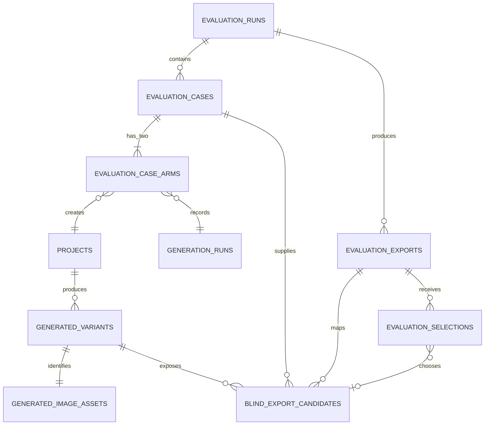

# Vision Engine Controlled Evaluation — ERD

**Status:** Proposed design  
**Scope:** Repeatable, blinded comparison of curated versus baseline generation.

## 1. Design summary

An evaluation is declared in a versioned YAML spec, then creates `N` **controlled
cases**. Each case has exactly two arms—`curated` and `baseline`—that share the
same immutable input snapshot. The only intended difference is `arm`.

The database is the source of truth. Full and blinded folders are derived exports,
not the data model.



## 2. New tables

### `evaluation_runs`

One invocation of `make evaluate`.

| Field | Purpose |
|---|---|
| `evaluation_run_id` (PK) | Stable `eval_...` ID |
| `spec_sha256` | SHA-256 of canonical validated YAML |
| `spec_json` | Immutable normalized spec snapshot |
| `requested_repetitions` | Requested `N` |
| `status` | `planned`, `running`, `completed`, `partial`, `failed` |
| `created_at`, `completed_at` | Lifecycle timestamps |

### `evaluation_cases`

One repeated input scenario. A case is created before either arm runs.

| Field | Purpose |
|---|---|
| `evaluation_case_id` (PK) | Stable `ecase_...` ID |
| `evaluation_run_id` (FK) | Parent evaluation |
| `case_input_sha256` | Hash of canonical structured input |
| `replicate_index` | `1..N` for the same input |
| `input_spec_json` | Room SHA, brief, room type, style, budget, constraints, inspiration SHAs |
| `status` | `planned`, `running`, `complete`, `partial`, `failed` |

**Unique:** `(evaluation_run_id, case_input_sha256, replicate_index)`.

### `evaluation_case_arms`

The exact pairing link. This removes the need to infer pairs by scanning folders
or matching independent UI runs later.

| Field | Purpose |
|---|---|
| `evaluation_case_arm_id` (PK) | Stable arm ID |
| `evaluation_case_id` (FK) | Parent case |
| `arm` | `curated` or `baseline` |
| `project_id` (FK) | Project created by the existing pipeline |
| `generation_run_id` (FK) | Generation provenance |
| `status` | Arm-level completion/failure state |
| `started_at`, `completed_at` | Retry and timing data |

**Unique:** `(evaluation_case_id, arm)`.

### `evaluation_exports`

Audit record for derived output bundles.

| Field | Purpose |
|---|---|
| `evaluation_export_id` (PK) | Stable `eexp_...` ID |
| `evaluation_run_id` (FK) | Exported evaluation |
| `export_type` | `full` or `blind` |
| `output_directory` | Resolved export path |
| `manifest_sha256` | Hash of generated manifest |
| `status`, `created_at` | Export lifecycle |

### `blind_export_candidates`

**Private mapping only.** Never copy this table or its arm values into the
evaluator-facing directory.

| Field | Purpose |
|---|---|
| `blind_candidate_id` (PK) | Opaque public ID, e.g. `candidate_04` |
| `evaluation_export_id` (FK) | Blind export |
| `evaluation_case_id` (FK) | Case shown to evaluator |
| `variant_id` (FK) | Original generated variant |
| `image_sha256` | Exact candidate bytes |
| `display_order` | Randomized order |

**Unique:** `(evaluation_export_id, evaluation_case_id, display_order)`.

### `evaluation_selections`

An evaluator response. One case can receive selections from multiple evaluators.

| Field | Purpose |
|---|---|
| `selection_id` (PK) | Stable selection ID |
| `evaluation_export_id` (FK) | Blind package used |
| `evaluation_case_id` (FK) | Evaluated case |
| `evaluator_id` | Optional reviewer identifier |
| `winner_candidate_id` (FK, nullable) | Opaque chosen candidate; null for skip/tie |
| `selection_method` | `csv` or `image_sha256` |
| `submitted_at` | Response time |

**Unique:** `(evaluation_export_id, evaluation_case_id, evaluator_id)`.

## 3. Existing tables reused

| Existing table | Role |
|---|---|
| `projects`, `uploads` | Persist the room/inspiration inputs and content hashes |
| `generation_runs` | Stores model, prompt version, references, and arm mode |
| `generated_variants` | Stores each generated A/B/C output |
| `generated_image_assets` | Stores each output's immutable SHA-256 |

`benchmark_cases` remains suitable for existing ad-hoc comparisons. Controlled
evaluations should use the explicit tables above so pairing is deterministic.

## 4. Export layout

```text
data/evaluations/                                  # default internal export
  eval_<id>/
    manifest.json                                  # full provenance and arm mapping
    report.json
    report.csv
    cases/case_<id>_rep_001/
      input/room.png
      curated/variant_a.png ...
      baseline/variant_a.png ...

~/Downloads/vision-engine-blind-evaluations/       # default; configurable
  blind_<export-id>/
    instructions.md
    response_template.csv
    cases/case_0001/
      room.png
      brief.txt
      candidates/candidate_01.png ... candidate_06.png
```

The blind package contains no arm, project, generation-run, or image-hash
mapping. Candidate files are randomized copies verified against
`generated_image_assets.image_sha256`.

## 5. Commands and lifecycle

```text
make evaluation-package CONFIG=configs/evaluation.yaml N=5 WORKERS=4
    → validate spec → create cases → bounded-parallel arms → report
    → full internal bundle + blinded evaluator package
    → prints eval_... and blind eexp_... IDs

make evaluation-score EXPORT_ID=eexp_... CSV=returned.csv
    → resolve opaque candidate IDs → calculate curated/baseline win proportions
    → write the internal selection report beside the full export
```

CSV selection is preferred because it is robust to renamed or recompressed files:

```csv
case_id,winner_candidate_id
case_0001,candidate_04
```

Image-only return is supported only when the evaluator returns byte-identical
files; the importer then resolves the winner by SHA-256.

