# Vision Engine Multimodal Retrieval and Indexing — ERD

**Status:** Engineering design  
**Scope:** Replace prototype hash embeddings with reproducible, real multimodal retrieval for curated reference selection  
**Primary goal:** Select architect-curated references that materially improve concept quality over a no-reference baseline, while preserving complete dataset, model, index, and scoring provenance.

---

## 1. Decision summary

The current Vision Engine retrieves references with `EMBEDDING_PROVIDER=fake`. The fake embedding client creates deterministic vectors from hashes of image bytes and text. This is suitable for offline tests, but it cannot represent visual or semantic design similarity.

The current Gemini adapter improves text embedding, but its image path remains prototype-grade: it combines a deterministic local image vector with filename/path text. It is not a true joint image-text representation.

This design introduces:

1. immutable curated-dataset snapshots;
2. content-addressed reference image assets;
3. versioned, real joint image-text embedding models and embedding artifacts;
4. reproducible vector-index versions and memberships;
5. multi-query candidate retrieval using visual, text, metadata, and lexical signals;
6. a second-stage multimodal reranker;
7. complete candidate-scoring provenance, not only final selected references; and
8. offline retrieval evaluation before an index version becomes active.

The design deliberately keeps three datasets separate:

```text
Curated reference dataset
  Architect-curated source references
  Used to guide retrieval and generation

Approved concept dataset
  Generated room concepts with architect review
  Used for outcome evaluation, preference learning, and future reranking

Evaluation dataset
  Held-out room/brief cases with relevance and benchmark judgments
  Used to prove curated retrieval beats baseline fairly
```

---

## 2. Objectives and non-goals

### Objectives

- Retrieve references using real visual and textual design similarity.
- Make every retrieval reproducible from a pinned dataset snapshot, embedding model, index version, and configuration version.
- Preserve the exact image bytes and annotation revision used to build each index.
- Use retrieval in two stages: broad recall first, precision reranking second.
- Keep hard filters, diversity, and architect-quality rules explicit and auditable.
- Measure reference-retrieval quality separately from end-to-end generation quality.
- Enable later review-trained reranking without rebuilding the data model.
- Allow safe rollback to an earlier active index.

### Non-goals

- Fine-tune an image-generation model in this phase.
- Automatically promote generated concepts into curated references.
- Treat vector similarity as proof that a reference is architecturally appropriate.
- Replace architect review with automated quality judgments.
- Require a distributed vector database for the local prototype before scale justifies it.

---

## 3. Current state and gap

### Current retrieval flow

```text
dataset_factory gold JSONL
→ dataset_records
→ local NumPy index
→ fake image/text embeddings
→ weighted hybrid score
→ top 8 candidates
→ diversity selection
→ final 3 references
→ Gemini concept + image-edit prompt
```

The current pipeline already records final `retrieval_runs` and `retrieval_run_references`. That is a good provenance foundation.

### Current limitations

```text
Fake embeddings:
  deterministic but not semantically meaningful

Dataset version:
  index filename only; no immutable snapshot or membership manifest

Index reproducibility:
  no model/dimension/normalization compatibility gate

Candidate provenance:
  final references only; no record of filtered/rejected candidates or score components

Reranking:
  fixed weighted score only; no multimodal precision stage

Evaluation:
  no independent retrieval relevance set or index promotion gate
```

### Why the distinction matters

Passing reference image bytes to Gemini can influence image editing. However, that only helps if the retrieval layer selects references that are genuinely relevant and architecturally useful.

```text
Good reference injection + weak reference selection
= unreliable or subtle curated advantage

Good reference injection + real multimodal retrieval + reranking
= a testable path to a material curated advantage
```

---

## 4. Data-model principles

### 4.1 Snapshot before indexing

Never build an index against a mutable folder without recording the exact record and asset versions used.

Every index is pinned to:

```text
dataset_snapshot_id
embedding_model_version_id
embedding_space_id
index_build_config_version
index_manifest_sha256
```

### 4.2 Assets are immutable; paths are not identities

Every source reference image uses a SHA-256 content hash. Storage paths may change; the hash identifies the bytes that were embedded.

### 4.3 Do not mix embedding spaces

Vectors are only comparable when they share:

```text
same embedding model version
same modality contract
same dimension
same normalisation procedure
same preprocessing configuration
```

An index must fail closed if these conditions are not true.

### 4.4 Retrieve broadly, then rerank precisely

Use a cheap high-recall first stage, then apply a stronger multimodal reranker to a small candidate set.

```text
room image + brief + metadata
→ candidate retrieval (top 20–50)
→ hard filters
→ multimodal reranking (top 6–12)
→ MMR/diversity selection
→ final 3 references
```

### 4.5 Preserve all candidate decisions

The final three references alone do not explain retrieval quality. Persist:

- candidates considered;
- hard-filter rejection reasons;
- every score component;
- reranker model/version;
- diversity role; and
- final selection decision.

### 4.6 Separate reference relevance from generation success

A reference may be visually relevant but still fail to produce a strong generation. Track both:

```text
Reference relevance judgment
  “Is this a good reference for this room and brief?”

Generation outcome
  “Did references selected for this run lead to an approved result?”
```

The first improves retrieval directly. The second supports later preference-trained reranking.

---

## 5. Target architecture

```text
Curator-approved references
→ immutable dataset snapshot
→ validated image assets + annotation revisions
→ real joint image-text embeddings
→ immutable vector index version
→ active index alias

Project room image + brief + constraints
→ image query embedding + text query embedding + structured filters
→ high-recall candidate search
→ multimodal reranker
→ diversity selection
→ final references
→ concept/image generation
→ architect review and benchmark outcome
→ future learned reranker training data
```

### 5.1 Embedding-model requirement

Use a model whose image and text embeddings live in the **same semantic vector space**. The model selection must be evaluated on interior-design retrieval, not assumed from generic benchmarks.

Implementation options:

```text
Local:
  SigLIP/CLIP-class joint vision-text embedding model
  Best for local control and predictable marginal cost

Hosted:
  A provider with documented multimodal embedding support where
  image and text are explicitly compatible in one vector space
  Best for operational simplicity if privacy/cost requirements allow
```

Selection criteria:

- image-to-image interior similarity;
- text-to-image style/material retrieval;
- UK/EU data-processing requirements;
- latency and cost;
- stable model/version availability;
- explicit embedding dimension and normalisation contract.

Do not label a text-only embedding model as multimodal merely because it can embed a filename or image caption.

### 5.2 Retrieval representation

Each reference should expose multiple retrieval signals:

```text
Visual:
  reference image embedding

Text:
  curator-authored design description
  materials, lighting, style, intervention level

Structured:
  room type, style family, budget, project type, rights status

Quality:
  architect review status and quality score

Negative:
  inappropriate-room conditions and known pitfalls
```

### 5.3 Query representation

The project query should include:

```text
room image embedding
optional inspiration image embeddings
brief embedding
structured constraints
room type / style / budget filters
```

Do not average incompatible vectors. A query embedding must be generated by the same joint model and preprocessing version as the index.

---

## 6. Proposed ERD

```mermaid
erDiagram
    CURATED_DATASET_SNAPSHOTS ||--o{ SNAPSHOT_REFERENCE_RECORDS : freezes
    DATASET_RECORDS ||--o{ SNAPSHOT_REFERENCE_RECORDS : versioned_in
    DATASET_RECORDS ||--o{ REFERENCE_IMAGE_ASSETS : has
    DATASET_RECORDS ||--o{ REFERENCE_ANNOTATION_REVISIONS : described_by
    REFERENCE_ANNOTATION_REVISIONS ||--o{ REFERENCE_ANNOTATION_TAGS : contains
    REFERENCE_TAGS ||--o{ REFERENCE_ANNOTATION_TAGS : classifies

    EMBEDDING_MODELS ||--o{ EMBEDDING_SPACES : defines
    EMBEDDING_SPACES ||--o{ EMBEDDING_BUILD_JOBS : used_by
    REFERENCE_IMAGE_ASSETS ||--o{ REFERENCE_EMBEDDINGS : represented_as
    REFERENCE_ANNOTATION_REVISIONS ||--o{ REFERENCE_EMBEDDINGS : described_as
    EMBEDDING_SPACES ||--o{ REFERENCE_EMBEDDINGS : contains
    EMBEDDING_BUILD_JOBS ||--o{ REFERENCE_EMBEDDINGS : produces

    CURATED_DATASET_SNAPSHOTS ||--o{ VECTOR_INDEX_VERSIONS : indexed_from
    EMBEDDING_SPACES ||--o{ VECTOR_INDEX_VERSIONS : compatible_with
    VECTOR_INDEX_VERSIONS ||--o{ VECTOR_INDEX_MEMBERSHIPS : includes
    SNAPSHOT_REFERENCE_RECORDS ||--o{ VECTOR_INDEX_MEMBERSHIPS : indexed_as
    VECTOR_INDEX_VERSIONS ||--o{ ACTIVE_INDEX_ALIASES : promoted_as

    RETRIEVAL_EXPERIMENTS ||--o{ RETRIEVAL_RUNS : configures
    VECTOR_INDEX_VERSIONS ||--o{ RETRIEVAL_RUNS : queried_against
    PROJECTS ||--o{ RETRIEVAL_RUNS : has
    RETRIEVAL_RUNS ||--o{ RETRIEVAL_QUERY_ARTIFACTS : represents
    UPLOADS ||--o{ RETRIEVAL_QUERY_ARTIFACTS : query_asset
    EMBEDDING_SPACES ||--o{ RETRIEVAL_QUERY_ARTIFACTS : embedded_in

    RETRIEVAL_RUNS ||--o{ RETRIEVAL_CANDIDATES : considers
    SNAPSHOT_REFERENCE_RECORDS ||--o{ RETRIEVAL_CANDIDATES : candidate
    RETRIEVAL_CANDIDATES ||--o{ RETRIEVAL_CANDIDATE_SCORES : scored_by
    RERANKER_MODELS ||--o{ RETRIEVAL_CANDIDATE_SCORES : calculates
    RETRIEVAL_CANDIDATES ||--o| RETRIEVAL_RUN_REFERENCES : selected_as

    RETRIEVAL_EVALUATION_SETS ||--o{ RETRIEVAL_EVALUATION_CASES : contains
    RETRIEVAL_EVALUATION_CASES ||--o{ REFERENCE_RELEVANCE_JUDGMENTS : judged_by
    SNAPSHOT_REFERENCE_RECORDS ||--o{ REFERENCE_RELEVANCE_JUDGMENTS : assessed
    RETRIEVAL_EVALUATION_SETS ||--o{ RETRIEVAL_EVALUATION_RUNS : evaluates
    VECTOR_INDEX_VERSIONS ||--o{ RETRIEVAL_EVALUATION_RUNS : measured
    RETRIEVAL_EVALUATION_RUNS ||--o{ RETRIEVAL_EVALUATION_RESULTS : reports
    RETRIEVAL_EVALUATION_CASES ||--o{ RETRIEVAL_EVALUATION_RESULTS : result_for

    DATASET_RECORDS {
        string image_id PK
        string source_record_id
        string review_status
        string payload_json
    }

    REFERENCE_IMAGE_ASSETS {
        string reference_asset_id PK
        string image_id FK
        string image_sha256 UK
        string storage_uri
        string mime_type
        integer width
        integer height
        integer file_size_bytes
        string rights_status
        string retention_consent_status
        datetime created_at
        datetime deleted_at
    }

    REFERENCE_ANNOTATION_REVISIONS {
        string annotation_revision_id PK
        string image_id FK
        integer revision_number
        string annotation_json
        string annotation_sha256
        string reviewer
        string status
        datetime created_at
    }

    REFERENCE_TAGS {
        string tag_code PK
        string tag_group
        string description
        boolean active
    }

    REFERENCE_ANNOTATION_TAGS {
        string annotation_revision_id FK
        string tag_code FK
        string confidence_source
    }

    CURATED_DATASET_SNAPSHOTS {
        string dataset_snapshot_id PK
        string snapshot_name UK
        string manifest_uri
        string manifest_sha256 UK
        integer record_count
        string status
        datetime created_at
        datetime sealed_at
    }

    SNAPSHOT_REFERENCE_RECORDS {
        string snapshot_reference_record_id PK
        string dataset_snapshot_id FK
        string image_id FK
        string reference_asset_id FK
        string annotation_revision_id FK
        string record_sha256
    }

    EMBEDDING_MODELS {
        string embedding_model_version_id PK
        string provider
        string model_name
        string model_revision
        string supported_modalities_json
        string preprocessing_config_json
        string model_card_uri
        datetime created_at
    }

    EMBEDDING_SPACES {
        string embedding_space_id PK
        string embedding_model_version_id FK
        string modality_contract
        integer dimension
        string distance_metric
        string normalisation
        string space_fingerprint UK
        datetime created_at
    }

    EMBEDDING_BUILD_JOBS {
        string embedding_job_id PK
        string embedding_space_id FK
        string dataset_snapshot_id FK
        string status
        string input_manifest_sha256
        string error_summary
        datetime started_at
        datetime completed_at
    }

    REFERENCE_EMBEDDINGS {
        string reference_embedding_id PK
        string reference_asset_id FK
        string annotation_revision_id FK
        string embedding_space_id FK
        string embedding_job_id FK
        string modality
        string vector_uri
        string vector_sha256
        string source_content_sha256
        datetime created_at
    }

    VECTOR_INDEX_VERSIONS {
        string vector_index_version_id PK
        string dataset_snapshot_id FK
        string embedding_space_id FK
        string index_backend
        string index_config_json
        string index_uri
        string index_manifest_sha256 UK
        integer vector_count
        string status
        datetime created_at
        datetime validated_at
        datetime promoted_at
    }

    VECTOR_INDEX_MEMBERSHIPS {
        string index_membership_id PK
        string vector_index_version_id FK
        string snapshot_reference_record_id FK
        string reference_embedding_id FK
        string vector_key
        datetime added_at
    }

    ACTIVE_INDEX_ALIASES {
        string active_index_alias PK
        string vector_index_version_id FK
        string environment
        datetime activated_at
        datetime deactivated_at
    }

    RETRIEVAL_EXPERIMENTS {
        string retrieval_experiment_id PK
        string name
        string config_json
        string config_sha256 UK
        string status
        datetime created_at
    }

    RETRIEVAL_RUNS {
        string run_id PK
        string project_id FK
        string retrieval_experiment_id FK
        string vector_index_version_id FK
        string mode
        string query_text
        datetime created_at
    }

    RETRIEVAL_QUERY_ARTIFACTS {
        string retrieval_query_artifact_id PK
        string retrieval_run_id FK
        string upload_id FK
        string embedding_space_id FK
        string modality
        string query_sha256
        string vector_uri
        datetime created_at
    }

    RETRIEVAL_CANDIDATES {
        string retrieval_candidate_id PK
        string retrieval_run_id FK
        string snapshot_reference_record_id FK
        integer initial_rank
        boolean passed_hard_filters
        string filter_reason
        boolean selected_for_rerank
        boolean selected_final
        datetime created_at
    }

    RERANKER_MODELS {
        string reranker_model_version_id PK
        string provider
        string model_name
        string model_revision
        string input_contract
        string training_dataset_snapshot_id
        string status
        datetime created_at
    }

    RETRIEVAL_CANDIDATE_SCORES {
        string retrieval_candidate_score_id PK
        string retrieval_candidate_id FK
        string reranker_model_version_id FK
        string stage
        string score_name
        float raw_score
        float normalised_score
        integer rank_after_stage
        string explanation_json
        datetime created_at
    }

    RETRIEVAL_RUN_REFERENCES {
        string retrieval_run_reference_id PK
        string retrieval_run_id FK
        string retrieval_candidate_id FK
        integer retrieval_rank
        float final_score
        string diversity_role
    }

    RETRIEVAL_EVALUATION_SETS {
        string retrieval_evaluation_set_id PK
        string name
        string split
        string manifest_uri
        string manifest_sha256 UK
        string status
        datetime created_at
    }

    RETRIEVAL_EVALUATION_CASES {
        string retrieval_evaluation_case_id PK
        string retrieval_evaluation_set_id FK
        string room_asset_sha256
        string brief
        string constraints_json
        string room_type
        string style_family
        datetime created_at
    }

    REFERENCE_RELEVANCE_JUDGMENTS {
        string relevance_judgment_id PK
        string retrieval_evaluation_case_id FK
        string snapshot_reference_record_id FK
        string reviewer
        integer relevance_score
        string rationale
        datetime judged_at
    }

    RETRIEVAL_EVALUATION_RUNS {
        string retrieval_evaluation_run_id PK
        string retrieval_evaluation_set_id FK
        string vector_index_version_id FK
        string retrieval_experiment_id FK
        string status
        datetime started_at
        datetime completed_at
    }

    RETRIEVAL_EVALUATION_RESULTS {
        string retrieval_evaluation_result_id PK
        string retrieval_evaluation_run_id FK
        string retrieval_evaluation_case_id FK
        string metrics_json
        string retrieved_reference_ids_json
        datetime created_at
    }
```



---

## 7. Entity definitions

### 7.1 Curated-data lineage

#### `reference_image_assets`

One immutable image asset belonging to a curated `dataset_record`.

Required fields:

```text
reference_asset_id              PK
image_id                        FK → dataset_records.image_id
image_sha256                    UNIQUE, NOT NULL
storage_uri                     NOT NULL
mime_type                       NOT NULL
width / height / file_size_bytes
rights_status                   NOT NULL
retention_consent_status        NOT NULL
created_at                      NOT NULL
deleted_at                      NULL
```

`storage_uri` is an operator-only path or object URI. It must not be surfaced through a public API.

#### `reference_annotation_revisions`

An append-only version of curator-authored metadata for a reference.

Examples of annotation fields:

```text
style_family
substyle
room_type
materials
colour_temperature
lighting_strategy
furniture_language
focal_point
spatial_hierarchy
appropriate_room_conditions
inappropriate_room_conditions
positive_why_it_works
negative_common_pitfalls
architect_quality_score
```

The index must point to one explicit annotation revision, never “whatever metadata is currently present.”

#### `curated_dataset_snapshots`

An immutable manifest of the exact approved records, assets, and annotation revisions eligible for an index build.

Recommended statuses:

```text
draft
validated
sealed
deprecated
```

Only `sealed` snapshots can create a promoted production index.

#### `snapshot_reference_records`

Pins each record in a snapshot to:

```text
dataset record
image asset
annotation revision
combined record hash
```

This prevents later image or metadata updates from silently changing old retrieval behaviour.

---

### 7.2 Embedding lineage

#### `embedding_models`

One versioned embedding-model contract.

Store:

```text
provider
model_name
model_revision
supported_modalities_json
preprocessing_config_json
model_card_uri
```

`model_revision` is mandatory. “latest” is not reproducible.

#### `embedding_spaces`

One compatible vector space emitted by an embedding model.

Examples:

```text
joint_image_text_v1
image_only_v1
metadata_text_v1
```

Store dimension, distance metric and normalisation. A vector index accepts exactly one `embedding_space_id`.

#### `embedding_build_jobs`

One asynchronous or local embedding run over a dataset snapshot.

It captures:

```text
source snapshot
embedding space
input manifest hash
job status
failure summary
timestamps
```

#### `reference_embeddings`

One embedding artifact for one reference asset or annotation revision.

Do not store large vectors as JSON in SQLite at scale. Store:

```text
vector_uri
vector_sha256
source_content_sha256
```

The vector may live in a local `.npy`/Parquet file initially, then object storage or a vector database at scale.

---

### 7.3 Index lineage

#### `vector_index_versions`

One immutable, buildable vector-index artifact.

Required:

```text
vector_index_version_id         PK
dataset_snapshot_id             FK
embedding_space_id              FK
index_backend                   numpy | faiss | pgvector | qdrant
index_config_json
index_uri
index_manifest_sha256           UNIQUE
vector_count
status
```

Recommended statuses:

```text
building
validation_failed
validated
active
superseded
retired
```

#### `vector_index_memberships`

One record for every reference embedding included in one index version.

This supports:

- exact rebuild verification;
- retrieval-result inspection;
- index diffing;
- removal of restricted/deleted source assets; and
- reproducible audit exports.

#### `active_index_aliases`

Maps an environment to an active index version:

```text
local
staging
production
```

Promote a tested index by changing the alias, not by overwriting an index file.

---

### 7.4 Retrieval and reranking provenance

#### `retrieval_experiments`

A versioned retrieval configuration, not an informal settings file.

Example `config_json`:

```json
{
  "candidate_k": 30,
  "final_k": 3,
  "fusion": "reciprocal_rank_fusion",
  "hard_filters": ["room_type", "rights_status", "review_status"],
  "diversity": {"algorithm": "mmr", "lambda": 0.7},
  "reranker": "multimodal-cross-encoder.v1"
}
```

This allows a fair baseline/curated evaluation to pin the retrieval treatment.

#### `retrieval_query_artifacts`

One or more persisted query representations per retrieval run:

```text
room_image
inspiration_image
brief_text
structured_constraints
```

The query hash prevents accidental comparison across changed inputs.

#### `retrieval_candidates`

Every candidate considered in a run. This is the central audit entity for retrieval quality.

Track:

```text
initial_rank
passed_hard_filters
filter_reason
selected_for_rerank
selected_final
```

#### `retrieval_candidate_scores`

One score explanation per candidate and scoring stage.

Recommended `stage` values:

```text
vector_image
vector_text
lexical
metadata
quality_prior
fusion
multimodal_reranker
preference_reranker
diversity
```

The `reranker_model_version_id` is nullable for deterministic scoring stages and required for learned model stages.

#### `reranker_models`

One versioned reranker contract.

Two future classes are expected:

```text
Multimodal cross-encoder
  Scores room image + brief + candidate reference directly

Preference-trained reranker
  Learns from approved/rejected generation outcomes
```

Do not deploy a learned preference reranker until review data is sufficiently diverse, consented, and held-out evaluated.

---

### 7.5 Retrieval evaluation

#### `retrieval_evaluation_sets` and `retrieval_evaluation_cases`

A held-out evaluation set for reference relevance—separate from generation benchmark cases.

Each case contains:

```text
room asset hash
brief
constraints
room type
style family
```

Cases must not be used to tune retrieval before final evaluation.

#### `reference_relevance_judgments`

Architect judgments for whether a candidate is a useful reference for a given case.

Use a 0–3 rubric:

```text
0 = unsuitable
1 = weak / generic
2 = useful supporting reference
3 = highly relevant reference
```

This creates ground truth for recall@K, nDCG@K and ranking comparison.

#### `retrieval_evaluation_runs` and `retrieval_evaluation_results`

Persist every offline evaluation of:

```text
index version
retrieval experiment
evaluation-set version
per-case metrics and retrieved IDs
```

---

## 8. Required constraints and invariants

### 8.1 Content integrity

```text
UNIQUE(reference_image_assets.image_sha256)

reference_embeddings.source_content_sha256
  must equal the SHA-256 of its source asset or annotation content.
```

### 8.2 Snapshot integrity

```text
Only sealed dataset snapshots may create validated or active index versions.

One snapshot membership must point to one concrete asset
and one concrete annotation revision.
```

### 8.3 Embedding compatibility

```text
All vector_index_memberships in one index version must use:
  the index's embedding_space_id
  the expected vector dimension
  the expected normalisation

Retrieval query artifacts must use the same embedding space as the queried index.
```

Reject incompatible vectors rather than silently truncating, padding, or averaging them.

### 8.4 Rights and curator eligibility

Only references satisfying all conditions are eligible for a production index:

```text
dataset_record.review_status = approved
reference_asset.deleted_at IS NULL
rights_status permits internal retrieval
snapshot is sealed
```

### 8.5 Index promotion

```text
Only validated index versions may become active.

At most one active alias per environment.

An active index is immutable; a change creates a new version.
```

### 8.6 Retrieval provenance

```text
Every curated retrieval_run must reference:
  retrieval_experiment_id
  vector_index_version_id
  candidate records
  final selections
```

Baseline retrieval runs retain no selected references, but should still record the same prompt/model configuration for fair benchmark comparisons.

---

## 9. Retrieval algorithm

### 9.1 Stage 0 — hard filters

Remove candidates that violate known requirements:

```text
not approved
restricted rights
wrong project type
strongly incompatible room type
explicitly inappropriate room condition
```

Hard filters are explainable and should not be replaced by an embedding score.

### 9.2 Stage 1 — high-recall candidate retrieval

Use multiple signals:

```text
joint image-to-image similarity:
  room image ↔ reference image

joint text-to-image similarity:
  brief/constraints ↔ reference image

text/metadata retrieval:
  brief ↔ curator annotation

structured quality prior:
  architect quality score and reviewed eligibility
```

Fuse ranked result lists using reciprocal-rank fusion or calibrated score fusion. Avoid uncalibrated addition of unrelated raw scores.

### 9.3 Stage 2 — multimodal reranking

For the top candidate set, score:

```text
(room image, brief, constraints, candidate reference image, candidate annotations)
```

The reranker should answer:

> “Would this reference help generate an appropriate design for this room and brief?”

It should not reward visual room-layout copying; it should reward applicable design language, materials, lighting, composition and intervention level.

### 9.4 Stage 3 — diversity selection

Use Maximal Marginal Relevance (MMR) or an equivalent constrained selection method to choose three complementary references:

```text
one close overall match
one material / lighting complement
one focal-point or composition complement
```

Persist the `diversity_role` and selection scores.

### 9.5 Stage 4 — reference-derived design grammar

The final references should be synthesised into structured, enforceable prompt context:

```text
reference-derived material direction
reference-derived lighting direction
reference-derived furniture language
reference-derived positive rules
reference-derived warnings
```

The baseline must use the same base prompt, geometry locks and model. Only the reference-derived evidence should differ.

---

## 10. Index build and promotion runbook

### 10.1 Build

```text
1. Curator validates references and seals a dataset snapshot.
2. Validate asset hashes, file format, dimensions, rights and annotations.
3. Create an embedding build job using one pinned joint embedding model.
4. Generate/validate reference embeddings.
5. Build a new immutable vector index version and membership manifest.
6. Run offline retrieval evaluation.
7. Record latency, failure rate, recall@K, nDCG@K and relevance metrics.
8. Promote only if gates pass; otherwise retain as validation_failed.
```

### 10.2 Promote

```text
1. Compare candidate index vs current active index on the held-out retrieval set.
2. Check no regression in rights, filtering, or latency.
3. Check end-to-end curated-vs-baseline benchmark results.
4. Atomically update active_index_aliases for the target environment.
5. Retain prior index for rollback.
```

### 10.3 Roll back

```text
1. Point the active alias at the prior validated vector_index_version_id.
2. Do not mutate or delete the failed candidate index.
3. Investigate candidate/score provenance and evaluator judgments.
```

---

## 11. Evaluation requirements

### 11.1 Retrieval quality metrics

Measure independently from generation:

```text
Recall@3 / Recall@10
nDCG@3 / nDCG@10
Mean reciprocal rank
Architect relevance score
Filter false-positive rate
Candidate and final-selection latency
```

### 11.2 End-to-end generation metrics

Use the existing benchmark-case and review-feedback architecture:

```text
curated winner acceptance rate
baseline winner acceptance rate
curated vs baseline blinded preference
geometry preservation score
taste quality score
material coherence score
severe failure-label rate
attempts to acceptable concept
```

### 11.3 Promotion gate

An index should not become active solely because its vector-search metrics improve. It should demonstrate:

```text
no meaningful retrieval-relevance regression
and
an improvement or non-regression in architect-reviewed end-to-end outcomes
```

The exact threshold should be established only after an initial held-out set is available. Do not invent a statistically significant result from three or four cases.

---

## 12. Migration plan

### Phase 1 — Data and schema foundation

1. Add reference assets, annotation revisions, tags, snapshots, model and embedding-space tables.
2. Backfill existing approved `dataset_records` into one initial snapshot.
3. Hash and validate all reference image assets.
4. Keep current `dataset_records` as the compatibility layer for existing code.

### Phase 2 — Real embedding/index build

1. Select and evaluate a joint image-text embedding model on a small labelled interior-design test set.
2. Create a new embedding space; do not reuse fake vectors.
3. Generate reference embeddings and build a versioned index.
4. Add compatibility checks and an active index alias.
5. Retain the NumPy index only as a local backend implementation, not as the identity of the index version.

### Phase 3 — Candidate and reranking provenance

1. Persist all candidates, filters and score components.
2. Add multi-query fusion and MMR diversity selection.
3. Add a multimodal reranker behind an experiment flag.
4. Audit selected references in the UI/operator reports.

### Phase 4 — Evaluation and feedback learning

1. Build held-out retrieval relevance cases with architect judgments.
2. Add blinded curated-vs-baseline benchmark review.
3. Train a conservative preference reranker only after sufficient consented review volume.
4. Promote indexes through evaluation gates and retain rollback capability.

---

## 13. Test requirements

### Unit tests

- source asset hash changes invalidate an embedding artifact;
- index rejects an embedding with the wrong space, dimension or normalisation;
- sealed snapshot cannot be mutated;
- restricted asset cannot enter a production index;
- only approved records enter a sealed production snapshot;
- active alias points to one validated index only;
- candidate-score rows retain scoring-stage provenance;
- baseline run contains no final references;
- MMR output has unique references and documented diversity roles.

### Integration tests

```text
seal snapshot
→ embed source assets
→ build index
→ validate membership manifest
→ retrieve candidates
→ rerank
→ select diverse final 3
→ record complete candidate provenance
→ reproduce the same result from pinned inputs
```

### Evaluation tests

```text
current active index vs candidate index
→ same held-out query set
→ same filters/configuration except tested change
→ compare Recall@K and nDCG@K
→ compare curated-vs-baseline review outcomes
→ block promotion on regression
```

---

## 14. Acceptance criteria

This work is complete when:

1. A curated index is tied to an immutable dataset snapshot and real embedding-space contract.
2. The system never mixes fake, text-only, or incompatible image vectors with a joint multimodal index.
3. Every final selected reference can be traced through candidate, score, reranker, embedding, asset, annotation, snapshot and index version.
4. Image assets used for retrieval are content-hashed and rights-validated.
5. A new index is evaluated before activation and can be rolled back.
6. Curated retrieval can be evaluated separately from generation quality.
7. Curated-vs-baseline generation tests pin index and experiment versions.
8. The architecture can later consume architect-review outcomes for a learned reranker without changing provenance assumptions.

---

## 15. Final recommendation

Implement in this order:

```text
immutable curated snapshots
→ real joint image-text embeddings
→ versioned index + compatibility gates
→ candidate-score provenance
→ multimodal reranker + MMR diversity
→ reference-derived design grammar
→ blinded retrieval and generation evaluation
→ review-trained preference reranker
```

Do not add a preference model or image-model fine-tuning until real multimodal retrieval and a robust evaluation gate demonstrate that the curated treatment materially improves architect-reviewed outcomes.
