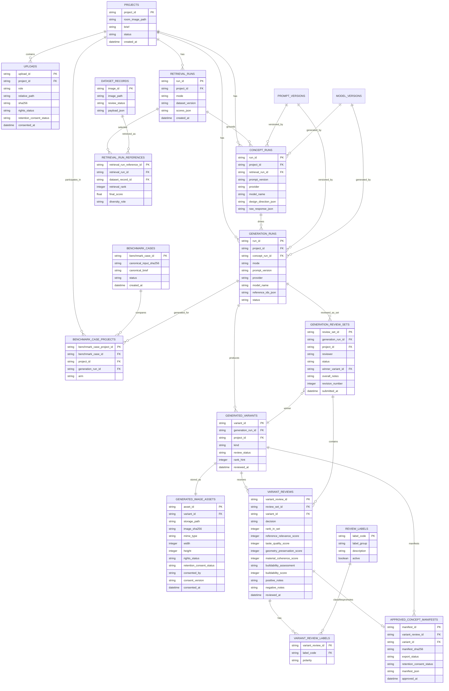

# Vision Engine Review Feedback Loop — ERD and UI Persistence Requirements

**Status:** Engineering design  
**Scope:** Architect Review in the local Vision Engine prototype  
**Primary goal:** Capture reliable review data for each generated variant, preserve complete provenance, and export explicitly approved concepts as a separate preference-learning dataset.

---

## 1. Decision summary

The current application stores generated files before review and can attach one `review_event` to one selected `variant_id`. That is useful for a prototype, but insufficient for a reliable feedback loop.

This design adds:

1. a **generation review set** for comparing all variants from one generation;
2. a **variant review** for individual decisions, scores, notes, and labels;
3. immutable **image hashes and consent metadata** for uploaded and generated assets;
4. an **approved concept manifest** for explicit, exportable promotion of an approved output;
5. a **benchmark case** that joins corresponding baseline and curated runs; and
6. a joined export view for evaluation, ranking, or future preference learning.

The existing `dataset_factory` gold dataset remains architect-curated reference data. An approved generated room concept must **not** automatically enter that dataset. It enters the separate approved-concept dataset only after explicit architect approval and rights/consent validation.

---

## 2. Objectives and non-goals

### Objectives

- Review every generated variant individually when needed.
- Rank variants as a comparative set.
- Make it impossible to save contradictory winner/rank states.
- Link every review to the exact generated image bytes through SHA-256.
- Capture whether image retention is permitted for internal review, evaluation, or model-training use.
- Preserve input, reference, prompt, model, direction, and reviewer provenance.
- Export a joined, reproducible manifest without exposing raw paths as a public API.
- Compare curated and baseline outputs for the same evaluation case.

### Non-goals

- Automatically fine-tune a model when someone clicks approve.
- Treat an approved image as construction-ready, technically accurate, or buildable.
- Merge generated images into the original reference-image gold dataset automatically.
- Build a multi-user authentication product in this iteration.

---

## 3. Current state and gap

### Current entities already implemented

```text
projects
uploads
dataset_records
retrieval_runs
concept_runs
generation_runs
generated_variants
review_events
prompt_versions
model_versions
```

### Current gap

The existing `review_events` table can point to one `variant_id`, but it does not model:

- a review of the whole A/B/C set;
- winner selection across variants;
- uniqueness of ranks;
- review state per variant;
- hashes/rights/consent for generated assets;
- an immutable approved-concept manifest;
- baseline/curated pairing; or
- a training/evaluation export joined to variant artifacts and full provenance.

---

## 4. Core data-model principles

### 4.1 Review the set and the variants

A generation produces a **set** of variants. The reviewer should:

1. compare the set and select at most one winner;
2. optionally rank all variants; and
3. give each variant an individual decision and, where useful, detailed scores.

This supports both:

- **comparative preference:** “Variant A is preferred to B and C”; and
- **diagnostic feedback:** “Variant B fails due to geometry.”

### 4.2 Store immutable artifact identity

Filesystem paths can change. A hash identifies the exact bytes reviewed.

Every generated image therefore needs:

- `image_sha256`
- `storage_path`
- MIME type
- width and height
- retention/rights/consent metadata

### 4.3 Keep generated concepts separate from curated references

There are two distinct datasets:

```text
Curated reference gold dataset
  Human-curated source images + approved design labels
  Used for retrieval

Approved generated concept dataset
  User room input + generated variant + architect review
  Used for evaluation, reranking, and later preference learning
```

### 4.4 Prefer append-only review revisions

Do not overwrite the only record of an architect’s judgment. A reviewer may revise their decision, but a new submission/version should retain the previous one for audit.

---

## 5. Proposed ERD



---

## 6. Entity definitions

### 6.1 Existing entities to retain

#### `projects`

One submitted room-design request. It retains the copied input image path, brief, constraints, style, room type, and lifecycle status.

#### `uploads`

One room or inspiration image provided for a project.

**Add:**

```text
rights_status
retention_consent_status
consented_by
consent_version
consented_at
consent_source
withdrawn_at
```

Recommended enums:

```text
rights_status:
  unknown
  user_owned
  licensed_for_internal_review
  licensed_for_evaluation
  licensed_for_model_training
  restricted

retention_consent_status:
  pending
  internal_review_only
  evaluation_allowed
  model_training_allowed
  withdrawn
  not_required
```

`model_training_allowed` must never be inferred from a generic upload. It requires an explicit affirmative consent record.

#### `retrieval_runs`, `concept_runs`, and `generation_runs`

Retain these as provenance records. They already identify:

- curated/baseline mode;
- selected references;
- prompt version;
- provider and model;
- design direction;
- errors and latency.

Add a normalized `retrieval_run_references` table instead of relying only on JSON strings for export/audit queries.

### 6.2 `generated_variants`

One A/B/C output from a generation run.

**Retain:**

```text
variant_id
generation_run_id
project_id
mode
kind
rank_hint
created_at
```

**Replace or add alongside `image_path`:**

```text
review_status
reviewed_at
image_asset_id
```

`review_status` is a denormalized convenience field for UI filtering. The authoritative detailed judgments remain in `variant_reviews`.

Recommended enum:

```text
variant_review_status:
  unreviewed
  in_review
  approved
  needs_edit
  rejected
  withdrawn
```

### 6.3 `generated_image_assets`

One immutable generated-image artifact per variant.

```text
asset_id                 PK
variant_id               FK, UNIQUE, NOT NULL
storage_path             NOT NULL
image_sha256             CHAR(64), UNIQUE, NOT NULL
mime_type                NOT NULL
width                    INTEGER
height                   INTEGER
file_size_bytes          INTEGER
rights_status            NOT NULL
retention_consent_status NOT NULL
consented_by             TEXT
consent_version          TEXT
consented_at             DATETIME
consent_source           TEXT
created_at               DATETIME NOT NULL
deleted_at               DATETIME
```

The application computes `image_sha256` immediately after writing the provider-returned bytes. The hash is what proves the reviewer saw the same bytes later exported in an approved-concept manifest.

### 6.4 `generation_review_sets`

One review submission for one architect reviewing one generation run as a set.

```text
review_set_id       PK
generation_run_id   FK, NOT NULL
project_id          FK, NOT NULL
reviewer            NOT NULL
status              NOT NULL
winner_variant_id   FK, NULL
overall_notes       TEXT
revision_number     INTEGER NOT NULL DEFAULT 1
supersedes_id       FK, NULL
created_at          DATETIME NOT NULL
submitted_at        DATETIME
```

Recommended enum:

```text
generation_review_set_status:
  draft
  submitted
  finalised
  superseded
```

`winner_variant_id` is nullable because the reviewer can choose **no acceptable variant**.

### 6.5 `variant_reviews`

One detailed review of one generated variant in one generation review set.

```text
variant_review_id               PK
review_set_id                   FK, NOT NULL
variant_id                      FK, NOT NULL
decision                        NOT NULL
rank_in_set                     INTEGER, NULL
reference_relevance_score       INTEGER, NULL
taste_quality_score             INTEGER, NULL
geometry_preservation_score     INTEGER, NULL
material_coherence_score        INTEGER, NULL
buildability_assessment         NOT NULL
buildability_score              INTEGER, NULL
positive_notes                  TEXT
negative_notes                  TEXT
reviewed_at                     DATETIME NOT NULL
```

Recommended enums:

```text
decision:
  approved
  needs_edit
  rejected
  not_assessable

buildability_assessment:
  assessable
  not_assessable_from_visual
  requires_site_verification
```

Rules:

- Scores are integers from 1 to 5 where supplied.
- `buildability_score` is required only when `buildability_assessment = assessable`.
- A reviewer must be able to say “not assessable from visual” rather than invent a buildability score.

### 6.6 `review_labels` and `variant_review_labels`

Use normalized labels rather than only a JSON list. This makes analytics and training exports reliable.

Example `review_labels`:

```text
label_code                  label_group     polarity
geometry_failure            failure         negative
window_changed              failure         negative
door_changed                failure         negative
fireplace_changed           failure         negative
lighting_problem            failure         negative
material_conflict           failure         negative
generic_ai_artifact         failure         negative
reference_mismatch          failure         negative
good_material_coherence     strength        positive
good_lighting_strategy      strength        positive
good_geometry_preservation  strength        positive
clear_focal_point           strength        positive
```

`variant_review_labels` links any number of labels to a review:

```text
variant_review_id   FK
label_code          FK
polarity            positive | negative
PRIMARY KEY (variant_review_id, label_code)
```

### 6.7 `approved_concept_manifests`

One immutable export-ready record for a deliberately promoted approved concept.

```text
manifest_id               PK
variant_review_id         FK, UNIQUE, NOT NULL
variant_id                FK, UNIQUE, NOT NULL
manifest_sha256           CHAR(64), UNIQUE, NOT NULL
manifest_schema_version   NOT NULL
export_status             NOT NULL
retention_consent_status  NOT NULL
manifest_json             NOT NULL
approved_at               DATETIME NOT NULL
exported_at               DATETIME
withdrawn_at              DATETIME
withdrawal_reason         TEXT
```

Recommended enum:

```text
approved_concept_export_status:
  pending_validation
  approved_for_evaluation
  approved_for_training
  exported
  withdrawn
  blocked_by_rights
```

The `manifest_json` is a frozen snapshot of all fields required to reproduce and evaluate the output. It should contain file references and hashes, not raw binary image content.

### 6.8 `benchmark_cases` and `benchmark_case_projects`

These entities connect baseline and curated outputs fairly.

`benchmark_cases` stores the canonical room image hash, brief, constraints, and evaluation status.

`benchmark_case_projects` connects each arm to its project and generation:

```text
benchmark_case_id
project_id
generation_run_id
arm: baseline | curated | user_inspiration | human_reference
```

This is required because current baseline/curated comparison creates separate projects. Without a benchmark case, downstream analysis cannot reliably prove they originated from the same input conditions.

---

## 7. Relationship and cardinality rules

```text
One project                 → many uploads
One project                 → many retrieval/concept/generation runs
One generation run          → one or more generated variants
One generated variant       → exactly one generated image asset
One generation run          → many review-set revisions
One review set              → one review for each included variant
One review set              → zero or one winner variant
One variant review          → many labels
One approved variant review → zero or one approved concept manifest
One benchmark case          → one or more baseline/curated project arms
```

---

## 8. Database constraints

These constraints must be enforced in SQLite/SQLAlchemy service code. UI validation alone is not sufficient.

### 8.1 Winner validity

```text
IF winner_variant_id IS NOT NULL:
  winner_variant_id must belong to the review set's generation_run_id.
```

### 8.2 Winner decision consistency

```text
IF winner_variant_id IS NOT NULL:
  matching variant_review.decision must be approved.

IF a variant_review.decision = approved:
  it must be the winner unless the review mode explicitly permits
  multiple independently approved options.
```

For iteration 1, use one winner maximum. It creates clear preference labels.

### 8.3 Rank validity

```text
UNIQUE(review_set_id, rank_in_set) WHERE rank_in_set IS NOT NULL
CHECK(rank_in_set >= 1)
CHECK(rank_in_set <= variant_count_in_generation_run)
```

On final submission:

```text
Either:
  every reviewed variant has a distinct rank
or:
  no rank is provided and winner-only review was selected.
```

### 8.4 One current review per reviewer/set

```text
UNIQUE(generation_run_id, reviewer, revision_number)
```

Only one `submitted` or `finalised` review revision should be current for the same reviewer and generation run. Older revisions become `superseded`.

### 8.5 Approved concept promotion validity

An `approved_concept_manifest` can only be created when:

```text
variant_review.decision = approved
variant_id = generation_review_set.winner_variant_id
generated_image_asset.image_sha256 is present
generated image rights_status is not restricted
retention_consent_status permits the intended export purpose
```

### 8.6 Buildability validity

```text
IF buildability_assessment = assessable:
  buildability_score IS NOT NULL AND BETWEEN 1 AND 5

IF buildability_assessment != assessable:
  buildability_score IS NULL
```

---

## 9. Architect Review UI requirements

### 9.1 Review context

At the top of Architect Review, display:

```text
Project ID
Generation run ID
Mode: curated or baseline
Room image thumbnail
Brief and constraints
Selected references
Concept title and design direction
Model and prompt version
```

The project ID is generated server-side during project creation. It is not supplied by the reviewer.

### 9.2 Set comparison section

Display all A/B/C variants side by side:

```text
[ Variant A ] [ Variant B ] [ Variant C ]

Select best:
  ( ) A
  ( ) B
  ( ) C
  ( ) No acceptable variant

Optional ordering:
  A: [1|2|3|unranked]
  B: [1|2|3|unranked]
  C: [1|2|3|unranked]

Overall notes: [...]
Save draft | Submit review
```

### 9.3 Individual variant card

Each variant card needs:

```text
Image thumbnail and Variant ID
Decision: approved | needs edit | rejected | not assessable
Scores: relevance, taste, geometry, material coherence
Buildability: assessable | not assessable from visual | requires site verification
Buildability score: only if assessable
Strength labels
Failure labels
Positive notes
Negative notes
Save variant review
```

The UI must clearly state:

```text
You are reviewing Variant B — Conservative.
```

### 9.4 Promotion action

Do not expose “Add to golden dataset.”

Use:

```text
Promote approved winner to evaluation dataset
```

Then ask:

```text
Can this room image and generated concept be retained?
  [ ] Internal architect review only
  [ ] Evaluation / quality improvement
  [ ] Future model training

Consent source / version: [...]
```

The action creates an `approved_concept_manifest`, not a `dataset_factory` gold reference record.

---

## 10. UI save API contracts

### 10.1 Save review draft

```json
{
  "generation_run_id": "gen_...",
  "project_id": "proj_...",
  "reviewer": "Lloyd Lee",
  "status": "draft",
  "winner_variant_id": null,
  "overall_notes": "",
  "variants": [
    {
      "variant_id": "var_a...",
      "decision": "needs_edit",
      "rank_in_set": null,
      "reference_relevance_score": 4,
      "taste_quality_score": 3,
      "geometry_preservation_score": 3,
      "material_coherence_score": 4,
      "buildability_assessment": "not_assessable_from_visual",
      "buildability_score": null,
      "labels": ["good_material_coherence", "window_changed"],
      "positive_notes": "Good palette.",
      "negative_notes": "Window opening changed."
    }
  ]
}
```

### 10.2 Submit review set

```json
{
  "generation_run_id": "gen_...",
  "project_id": "proj_...",
  "reviewer": "Lloyd Lee",
  "status": "submitted",
  "winner_variant_id": "var_a...",
  "overall_notes": "A is closest to the intended restrained direction.",
  "variants": [
    {
      "variant_id": "var_a...",
      "decision": "approved",
      "rank_in_set": 1,
      "reference_relevance_score": 5,
      "taste_quality_score": 5,
      "geometry_preservation_score": 4,
      "material_coherence_score": 5,
      "buildability_assessment": "requires_site_verification",
      "buildability_score": null,
      "labels": [
        "good_material_coherence",
        "good_lighting_strategy",
        "good_geometry_preservation"
      ],
      "positive_notes": "Strong calm palette and appropriate intervention level.",
      "negative_notes": "Pendant location requires site verification."
    },
    {
      "variant_id": "var_b...",
      "decision": "rejected",
      "rank_in_set": 2,
      "reference_relevance_score": 3,
      "taste_quality_score": 2,
      "geometry_preservation_score": 4,
      "material_coherence_score": 2,
      "buildability_assessment": "not_assessable_from_visual",
      "buildability_score": null,
      "labels": ["material_conflict"],
      "positive_notes": null,
      "negative_notes": "Metal finish conflicts with the room."
    }
  ]
}
```

### 10.3 Promote approved concept

```json
{
  "variant_review_id": "vr_...",
  "purpose": "evaluation_allowed",
  "consented_by": "Lloyd Lee",
  "consent_version": "review-consent.v1"
}
```

The server validates promotion conditions, computes the manifest hash, writes the immutable manifest, and returns `manifest_id`.

---

## 11. Approved concept manifest

### 11.1 Minimum manifest shape

```json
{
  "manifest_schema_version": "approved-concept.v1",
  "manifest_id": "acm_...",
  "approved_at": "2026-07-21T...",
  "review": {
    "review_set_id": "grs_...",
    "variant_review_id": "vr_...",
    "reviewer": "Lloyd Lee",
    "decision": "approved",
    "rank_in_set": 1,
    "scores": {
      "reference_relevance": 5,
      "taste_quality": 5,
      "geometry_preservation": 4,
      "material_coherence": 5,
      "buildability_assessment": "requires_site_verification"
    },
    "labels": ["good_material_coherence", "good_lighting_strategy"]
  },
  "input": {
    "project_id": "proj_...",
    "room_image_sha256": "…",
    "brief": "…",
    "constraints": ["…"]
  },
  "output": {
    "variant_id": "var_...",
    "image_sha256": "…",
    "storage_path": "data/generated/…",
    "retention_consent_status": "evaluation_allowed"
  },
  "generation": {
    "generation_run_id": "gen_...",
    "mode": "curated",
    "provider": "gemini",
    "model_name": "…",
    "prompt_version": "image_edit",
    "concept_direction": {},
    "retrieved_reference_ids": ["img_…"]
  }
}
```

### 11.2 Export formats

Provide:

```text
approved_concepts.jsonl
approved_concepts.parquet
review_training_export_v1.jsonl
```

Exports contain file paths and hashes. A separate portable export mode may copy permitted images into an export folder, but only when the relevant consent status allows it.

---

## 12. Joined export view

Define a read-only logical view named:

```text
review_training_export_v1
```

One row per reviewed variant. It joins:

```text
projects
→ uploads (original room)
→ retrieval_runs
→ retrieval_run_references
→ concept_runs
→ generation_runs
→ generated_variants
→ generated_image_assets
→ variant_reviews
→ variant_review_labels
→ generation_review_sets
→ approved_concept_manifests
```

Required output fields:

```text
project_id
generation_run_id
generation_mode
variant_id
variant_kind
room_image_path
room_image_sha256
generated_image_path
generated_image_sha256
brief
constraints_json
retrieved_reference_ids_json
retrieved_reference_scores_json
design_direction_json
concept_prompt_version
image_prompt_version
provider
model_name
reviewer
review_set_status
winner_variant_id
variant_decision
rank_in_set
all_scores_json
buildability_assessment
positive_labels_json
negative_labels_json
positive_notes
negative_notes
retention_consent_status
approved_manifest_id
manifest_sha256
created_at
reviewed_at
approved_at
```

No public UI or API should expose arbitrary local paths. The export is a controlled local operator artifact.

---

## 13. Baseline-versus-curated benchmark design

A fair comparison requires a shared benchmark case:

```text
One canonical room image
One canonical brief and constraints
One evaluation case
  ├── curated generation run
  └── baseline generation run
```

Rules:

- Both arms use the same room image hash and brief snapshot.
- Both arms use the same image model and comparable generation settings.
- The curated arm may use retrieved references.
- The baseline arm must have no retrieved references.
- Reviewers see anonymised outputs during benchmark review.
- The benchmark records whether each output was preferred, accepted, or failed.

This makes the statement “curated is better than baseline” testable rather than anecdotal.

---

## 14. Migration plan

### Phase 1 — Artifact integrity and review sets

1. Add SHA-256, MIME, dimensions, rights, and consent fields to `uploads`.
2. Create `generated_image_assets`.
3. Add `review_status` and `reviewed_at` to `generated_variants`.
4. Create `generation_review_sets` and `variant_reviews`.
5. Migrate existing `review_events` into `variant_reviews` where possible.
6. Keep `review_events` as a legacy/audit source until migration is verified.

### Phase 2 — UI and validation

1. Replace the single Variant dropdown with set comparison plus individual cards.
2. Add save-draft and submit-review actions.
3. Add server-side winner/rank validation.
4. Add labels and `not_assessable_from_visual`.
5. Make the selected review target explicit in every save confirmation.

### Phase 3 — Promotion and export

1. Implement approved-concept manifest creation.
2. Add consent capture and rights gates.
3. Implement `review_training_export_v1`.
4. Implement approved-concepts JSONL/Parquet export.
5. Add controlled portable image export only for permitted assets.

### Phase 4 — Benchmarking

1. Add benchmark cases and generation arms.
2. Add blinded comparison review.
3. Report curated preference, geometry, acceptance, retries, latency, and cost.

---

## 15. Test requirements

### Unit tests

- winner belongs to generation run;
- no duplicate rank within a review set;
- only one winner;
- winner must have approved decision;
- buildability score is invalid when not assessable;
- promotion rejects restricted or non-consented artifacts;
- manifest hash is stable for unchanged inputs;
- export excludes withdrawn manifests.

### Integration tests

```text
generate A/B/C
→ save review draft
→ submit review with winner and ranks
→ save individual rejected-variant label
→ promote approved winner
→ export joined approved-concept manifest
→ verify output image hash and provenance chain
```

### Golden tests

Maintain fixed projects where expected results include:

- set winner;
- variant scores;
- failure labels;
- approved manifest content;
- baseline/curated benchmark pair.

---

## 16. Acceptance criteria

The implementation is complete when:

1. The UI can save a set-level review and individual variant reviews directly to SQLite.
2. The reviewer always sees which image/variant is being reviewed.
3. Each generated image has an immutable hash and storage metadata.
4. A submitted review cannot contain an invalid winner or contradictory ranks.
5. Buildability can be marked not assessable rather than scored artificially.
6. An approved concept is promoted only through explicit consent/rights checks.
7. The approved-concept export joins input, output, review, retrieval, prompt, model, and consent provenance.
8. Curated and baseline runs can be attached to the same benchmark case.
9. The original `dataset_factory` gold export remains unchanged unless a separate curator workflow deliberately adds a source reference image.

---

## 17. Final recommendation

Build the review loop in this order:

```text
generation-set winner + per-variant review
→ immutable image hash and consent metadata
→ approved concept manifest/export
→ baseline-versus-curated benchmark cases
→ retrieval/ranking improvement from reviewed decisions
```

Do not start with model fine-tuning. First build the reliable human-review, provenance, and benchmark dataset that can prove whether the system improves approval rate and reduces revision cycles.
